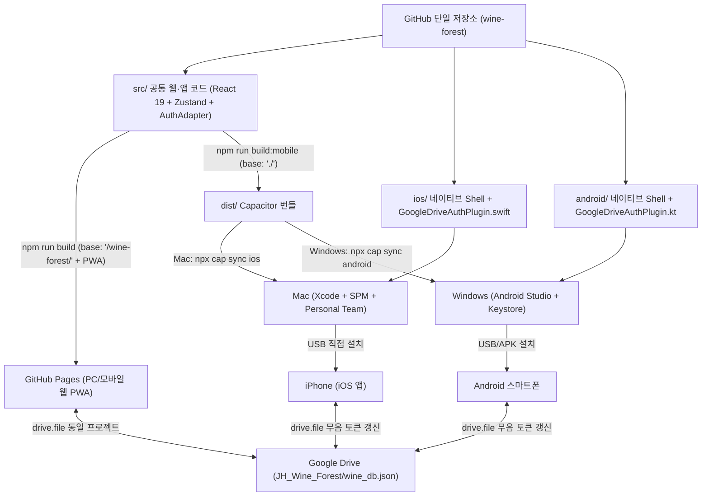

# JH Wine Forest — 모바일 앱(iOS / Android) 전환 마스터 구현 계획 (Mobile v1.0)

> **연관 문서 (모바일 시리즈):**
> - **상태:** **READY FOR M1 — 웹 Phase 2 (2-1·2-2·2-3A) 및 모바일 호환 5원칙 선반영 완료 (사용자 지시 시 모바일 M1 즉시 착수 가능)**
> - **마스터 구현 계획:** `MOBILE_IMPLEMENTATION_PLAN.md` (본 문서)
> - **Mac · iOS(+공통 코드 & Android 선행) 개발 작업지시서:** [SPEC_MOBILE_IOS.md](./SPEC_MOBILE_IOS.md)
> - **Windows · Android 빌드/배포 실전 가이드:** [GUIDE_WIN_ANDROID.md](./GUIDE_WIN_ANDROID.md)
> - **기존 웹앱 마스터 명세:** [SPEC_1_UI_ARCH.md](./SPEC_1_UI_ARCH.md) · [SPEC_2_DATA_EXEC.md](./SPEC_2_DATA_EXEC.md) · [IMPLEMENTATION_PLAN.md](./IMPLEMENTATION_PLAN.md)
>
> **목표:** 기존 웹 PWA 코드베이스(`React 19 + Vite 6 + Zustand + IndexedDB`)를 95% 이상 재사용하여 **iOS / Android 네이티브 앱**으로 패키징하고, 매번 웹 팝업 로그인을 반복하지 않는 **무음 자동 갱신 네이티브 Google 로그인**을 구현합니다.

---

## 1. 확정 의사결정 요약표

| 항목 | 확정 내용 | 비고 |
| :--- | :--- | :--- |
| **앱 프레임워크** | **Capacitor 8** (단일 Git 저장소 `wine-forest`) | 웹·iOS·Android 공통 `src/` 코드 95%+ 공유 |
| **앱 식별자 (App ID)** | **`com.jihoon.wineforest`** | iOS Bundle ID 및 Android Application/Package ID 동일 적용 |
| **표시 이름** | `JH Wine Forest` (`short_name`: `Wine Forest`) | 기존 PWA 매니페스트와 동일 |
| **빌드 PC 이원화 전략** | **Mac (iOS 전용) + Windows (Android 전용)** | Git 저장소는 1개 유지, 빌드/실기기 배포 환경만 PC별로 역할 분담 |
| **Android 선행 코드** | **Mac에서 스캐폴딩 + Kotlin 플러그인까지 선행 커밋** | Windows에서는 `git pull` → Keystore/SHA-1 등록 → 빌드만 수행 |
| **네이티브 Google 인증** | **방식 A: 공식 SDK 경량 커스텀 로컬 플러그인** (`GoogleDriveAuth`) | iOS `GoogleSignIn-iOS` (SPM) + Android `AuthorizationClient` (`play-services-auth`) |
| **OAuth 스코프 및 프로젝트** | `https://www.googleapis.com/auth/drive.file` (**기존 웹과 동일 Google Cloud 프로젝트**) | 3기기(PC 웹·iOS·Android)가 동일한 `JH_Wine_Forest/wine_db.json` 공유 |
| **OAuth 동의 화면 상태** | **프로덕션(Production) 게시 전환** | Refresh Token 7일 만료 제한 해제 → **사실상 영구 자동 로그인** (`drive.file`은 비민감 스코프) |
| **iOS 의존성 및 서명** | **SPM (`CapApp-SPM`) + 무료 Personal Team USB 설치** | CocoaPods 미설치로 Mac 디스크 절약 (추후 연 \$99 TestFlight 업그레이드 가능) |
| **1차 포함 모바일 UX** | ① JSON 내보내기 네이티브 공유 시트 ② OS 상태바 라이트/다크 자동 연동 ③ Android 뒤로가기(모달/라우트) 처리 | 햅틱 진동(`@capacitor/haptics`)·CI Android APK 자동 빌드는 1차 범위 제외 |
| **현재 작업 순서** | **경로 A (웹 Phase 2 선행 구현 → 완료 후 모바일 전환 착수, 현재 네이티브 구현 ON HOLD)** | 사전 밑작업(`.gitattributes`, `.gitignore`, 호환 가이드)만 선반영 |

---

## 2. 단일 저장소 · 이원화 빌드 아키텍처

### 핵심 설계 원칙
1. **웹앱 하위 호환성 100% 보장:** 기존 [deploy.yml](../.github/workflows/deploy.yml)과 GitHub Pages 배포 경로(`/wine-forest/`), GIS 웹 로그인, Workbox PWA 동작은 단 1줄의 기능 저하 없이 그대로 유지됩니다.
2. **플랫폼 분기 추상화 (`AuthAdapter` & `nativeBridge`):** 기존 [types.ts](../src/services/storage/types.ts)의 `StorageAdapter` 패턴과 동일하게 인증(`AuthAdapter`) 및 OS 브릿지(`nativeBridge.ts`)를 인터페이스화하여 UI/스토어 코드에 네이티브 분기가 난립하지 않게 합니다.
3. **Public 저장소 보안 절대 준수:** iOS OAuth Client ID(`Local.xcconfig`), Android Keystore(`*.keystore`, `*.jks`, `keystore.properties`), `.env.local` 등 비밀/식별 설정 파일은 모두 `.gitignore`로 차단하고 예제 템플릿(`*.example`)만 저장소에 커밋합니다.

---

## 3. 공통 코드(`src/`) 및 루트 설정 변경 영향 범위

| 대상 경로 | 변경 유형 | 변경 내용 요약 |
| :--- | :---: | :--- |
| `package.json` | 수정 | Capacitor 8 코어·플랫폼·공식 플러그인(`app`, `status-bar`, `filesystem`, `share`) 및 `build:mobile`, `cap:sync:*`, `cap:open:*` 스크립트 추가 |
| `vite.config.ts` | 수정 | `process.env.BUILD_TARGET === 'capacitor'`일 때 `base: './'` 적용 및 `VitePWA` 비활성화 (웹 기본 빌드는 `/wine-forest/` + PWA 유지) |
| `capacitor.config.ts` | 신규 | `appId: 'com.jihoon.wineforest'`, `appName: 'JH Wine Forest'`, `webDir: 'dist'`, iOS `contentInset` 및 플러그인 옵션 정의 |
| `.gitignore` | 수정 | `ios/App/Config/Local.xcconfig`, `*.keystore`, `*.jks`, `keystore.properties`, `*.p12`, `*.mobileprovision`, `GoogleService-Info.plist` 차단 추가 |
| `.gitattributes` | 신규 | Mac/Windows 간 `gradlew`, `*.sh`, `*.bat`, `*.swift`, `*.kt` 줄바꿈(LF/CRLF) 충돌 방지 규칙 명시 |
| `src/plugins/googleDriveAuth.ts` | 신규 | `registerPlugin<GoogleDriveAuthPlugin>('GoogleDriveAuth')` TypeScript 브릿지 정의 |
| `src/services/auth/types.ts` | 신규 | `AuthTokenResult`, `AuthAdapter` 인터페이스 정의 |
| `src/services/auth/webGisAuthAdapter.ts` | 신규 | 기존 `googleAuth.ts`의 브라우저 GIS 토큰 모델 로직 이전 |
| `src/services/auth/nativeGoogleAuthAdapter.ts` | 신규 | 네이티브 `GoogleDriveAuth` 래핑, 만료 버퍼 체크, 동시 갱신 single-flight dedupe, `forceRefresh` 지원 |
| `src/services/auth/googleAuth.ts` | 수정 | `Capacitor.isNativePlatform()` 기반 파사드 (기존 export 유지 + `ensureAccessToken`, `restoreAuthSession`, `getCurrentAuthEmail` 등 추가) |
| `src/services/native/nativeBridge.ts` | 신규 | `syncStatusBar(theme)`, `exportJsonWithNativeShare()`, `initAndroidBackButton()` 구현 (웹 환경에서는 안전 no-op/폴백) |
| `src/services/storage/googleDriveAdapter.ts` | 수정 | 동기 `requireToken()` → 비동기 `ensureAccessToken()` 전환, HTTP `401` 수신 시 네이티브 강제 갱신 후 **자동 1회 재시도** |
| `src/store/useWineStore.ts` | 수정 | `hydrate()` 시 네이티브 자동 세션 복원(`restoreSession`) 및 백그라운드 동기화, `commitMutation()` 시 무음 토큰 갱신, `exportLocalJson()` 네이티브 공유 연동, `disconnectAndResetLocal()` 시 네이티브 로그아웃 |
| `src/components/common/BottomSheet.tsx` | 수정 | Android 뒤로가기 버튼 우선 처리를 위한 열린 모달/시트 닫기 스택 등록(웹 동작 무영향) |
| `src/components/layout/AppShell.tsx` | 수정 | Android 하드웨어 뒤로가기 리스너 초기화, 네이티브 재인증 배너 문구 분기 |
| `src/pages/OnboardingView.tsx` | 수정 | 네이티브 환경에서는 `VITE_GOOGLE_CLIENT_ID` 웹 전용 가드 없이 바로 `[Google 계정으로 시작하기]` 활성화 |
| `src/pages/SettingsPage.tsx` | 수정 | 네이티브 환경에서 현재 로그인된 Google 계정 이메일·세션 상태 표시 및 수동 재연결 안내 보완 |
| `tests/authAdapter.test.ts` | 신규 | 웹 GIS 호환, 네이티브 무음 복원, 401 자동 1회 재시도, 사용자 취소 처리, 동시 갱신 dedupe 단위 테스트 |

---

## 4. Phase 2 웹 개발 시 모바일 호환 5원칙 (선반영 완료 · 다음 작업자 인수인계)

경로 A에 따라 웹 Phase 2(라벨·시음 사진, 구조화된 시음노트·5점 별점, 음용적기 관리)가 **모바일 호환 5원칙을 100% 준수한 상태로 구현 완료**되었습니다. 모바일 M1~M3 착수 작업자는 아래 단일 지점만 연결하면 UI 컴포넌트 수정 없이 네이티브 연동을 끝낼 수 있습니다.

1. **사진 조회/업로드 추상화 (완료 ✅):** `JH_Wine_Forest/photos/` 업로드·조회·삭제는 [types.ts](../src/services/storage/types.ts) `StorageAdapter`(`uploadPhoto`/`downloadPhoto`/`deletePhoto`)로 추상화되었고, [photoLoader.ts](../src/services/media/photoLoader.ts)가 `fetchDrive` Blob 다운로드 + IndexedDB 캐시(Object URL)로 렌더링합니다. *(주의: M2에서 `googleDriveAdapter.ts`를 비동기 `ensureAccessToken()`으로 전환할 때 `photoLoader.ts`의 `photoDriveClient`도 동일 어댑터를 타므로 자동 적용됩니다.)*
2. **이미지 선택 · 리사이징 단일 진입점 분리 (완료 ✅):**
   - **파일 선택/촬영 단일 훅:** [photoPicker.ts](../src/services/media/photoPicker.ts)의 `pickImageFile(options)`로 `WineDetailSheet`, `QuickConsumeModal`, `HistoryCard` 3곳이 모두 단일화되어 있습니다. **모바일 M2 착수 시 UI 파일은 수정하지 말고 `photoPicker.ts` 상단에 `@capacitor/camera` 분기만 추가**하십시오(상세 예시 코드 주석 포함).
   - **압축/리사이징:** [imageProcessor.ts](../src/services/media/imageProcessor.ts)가 `Blob`(웹 `File` 및 Capacitor `Camera.getPhoto` Blob 모두 수용)을 받아 라벨 `500px` / 시음 `1024px` WebP로 자동 압축합니다.
3. **IndexedDB 스키마 업그레이드 안전성 (완료 ✅):** [localCache.ts](../src/services/storage/localCache.ts)는 이미 `DB_VERSION = 2`로 업그레이드되어 `!db.objectStoreNames.contains('photoCache')` 가드로 기존 `appState`·`localBackups`를 보존합니다.
4. **시음노트 `<textarea>` 모바일 레이아웃 (완료 ✅):** [QuickConsumeModal.tsx](../src/components/wines/QuickConsumeModal.tsx)의 상세 시음노트 `<textarea>`는 [BottomSheet.tsx](../src/components/common/BottomSheet.tsx) 내부 스크롤 영역 안에 배치되어 있습니다.
5. **음용적기 판단 로직 순수 함수 분리 (완료 ✅):** [wineHelpers.ts](../src/services/domain/wineHelpers.ts)의 `getDrinkingWindowStatus()`와 [statsCalculator.ts](../src/services/analytics/statsCalculator.ts)의 `calculateDrinkingWindowSummary()`가 순수 함수로 분리되어 있어 추후 `@capacitor/local-notifications` 스케줄러에 그대로 연결할 수 있습니다.

---

## 5. Phase M1 ~ M6 마일스톤 로드맵

현재 Mac 환경(Intel `x86_64`, SSD 여유 ~112GB, Xcode/Android Studio 미설치)과 경로 A(웹 Phase 2 완료 후 착수)를 기준으로, **Xcode 설치 전 선행 작업(M1~M3)**과 **환경 설치 후 네이티브 빌드·검증(M4~M6)**을 분리합니다.

### [Xcode 설치 전 가능] 공통 코드 & 양 플랫폼 스캐폴딩 (Mac)
* **Phase M1 — Capacitor 기반 설정 & 듀얼 빌드 파이프라인:**
  * `capacitor.config.ts`, `vite.config.ts`, `package.json` 구성 (`.gitattributes`, `.gitignore` 모바일 규칙은 사전 반영 완료).
  * Phase 2 기능 완료 상태에 맞춰 필요 플러그인(`@capacitor/camera`, OS 로컬 알림 채택 시 `@capacitor/local-notifications`)을 함께 설치.
  * **검증:** `npm run build` (웹 `/wine-forest/` + `dist/sw.js`) 및 `npm run build:mobile` (모바일 `./` + SW 미포함) 모두 성공.
* **Phase M2 — `AuthAdapter` 추상화 · 네이티브 UX 브릿지 · 스토어 연동:**
  * `src/plugins/googleDriveAuth.ts`, `src/services/auth/*`, `src/services/native/nativeBridge.ts`, `googleDriveAdapter.ts`, `useWineStore.ts`(`detectDeviceLabel()` 네이티브 `iOS App`/`Android App` 분기 포함), UI(모달 뒤로가기 스택·온보딩·설정) 구현.
  * **검증:** `npm run typecheck`, `npm run test` (기존 스위트 + 신규 `tests/authAdapter.test.ts` 전체 통과).
* **Phase M3 — iOS/Android 스캐폴딩 & 네이티브 플러그인 코드 작성:**
  * `npx cap add ios --packagemanager SPM` & `npx cap add android` 생성.
  * iOS: `GoogleDriveAuthPlugin.swift`, `WineForestViewController.swift`, `AppDelegate.swift`(및 `SceneDelegate.swift`), `Local.xcconfig.example`, `Info.plist` 구성 (Phase 2 카메라/사진 권한 `NSCameraUsageDescription`, `NSPhotoLibraryUsageDescription` 포함).
  * Android: `GoogleDriveAuthPlugin.kt`, `MainActivity` 등록, `android/app/build.gradle` 의존성·조건부 릴리스 서명 블록, `AndroidManifest.xml` 권한(카메라·선택적 알림) 구성 후 Git 커밋·푸시.
  * **검증:** Git 커밋 및 `origin/main` 푸시 (Windows에서 바로 pull 가능 상태 확보).

### [IDE 설치 후 진행] 플랫폼별 빌드 · OAuth 연동 · 실기기 검증
* **Phase M4 — Mac Xcode 환경 구축 & Google Cloud 프로덕션 전환:**
  * Mac App Store에서 Xcode 설치 (단일 iOS 시뮬레이터 런타임만 설치해 SSD 공간 절약), `GoogleSignIn-iOS` SPM 패키지 연결.
  * 기존 Google Cloud 프로젝트에 iOS OAuth 클라이언트(`com.jihoon.wineforest`) 추가 및 OAuth 동의 화면 `프로덕션(Production)` 게시.
  * **검증:** `xcodebuild` 시뮬레이터/기기 빌드 에러 0건.
* **Phase M5 — iOS 실기기 무음 로그인 · 동기화 · 공유 시트 검증 (Mac USB):**
  * 무료 Apple ID(Personal Team) 서명으로 iPhone 실기기 설치 후 최초 1회 로그인 → 앱 강제 종료 후 재실행 시 로그인 팝업 없이 자동 동기화, JSON 공유 시트, 다크/라이트 상태바, Phase 2 카메라/라벨 사진 연동 검증.
* **Phase M6 — Windows PC에서 Android 빌드 & 3기기 교차 동기화 검증:**
  * [GUIDE_WIN_ANDROID.md](./GUIDE_WIN_ANDROID.md) 절차에 따라 Windows PC에 Android Studio 설치 → Debug/Release Keystore SHA-1을 동일 Google Cloud 프로젝트에 등록 → 실기기 검증 → **PC 웹 · iPhone · Android 3기기 간 실시간 `wine_db.json` 동기화 및 충돌 모달 검증 완료**.

---

## 6. 기존 웹앱(GitHub Pages PWA) 100% 하위 호환성 체크리스트

- [ ] `npm run build` 실행 시 `dist/index.html`의 에셋 경로가 `/wine-forest/`로 유지되고 `dist/sw.js`, `dist/manifest.webmanifest`가 정상 생성되는가?
- [ ] `BUILD_TARGET=capacitor` 미지정 상태에서 `Capacitor.isNativePlatform()`이 `false`로 평가되어 웹 브라우저가 항상 `WebGisAuthAdapter`를 타는가?
- [ ] 웹 환경에서 `nativeBridge.ts`의 StatusBar / App / Filesystem / Share 호출이 동적/안전 가드로 스킵되거나 기존 Blob 다운로드로 폴백되는가?
- [ ] 기존 테스트 스위트(`privacyMode.test.tsx`, `schemaValidation.test.ts`, `statsCalculator.test.ts`, `syncConflict.test.ts`, `wineStore.test.ts`, `phase2.test.tsx` — 총 6개 스위트 / 28개 테스트)가 단 1건의 회귀 없이 모두 통과하는가?
- [ ] `.github/workflows/deploy.yml`의 `npm run typecheck && npm run test && npm run build` CI 파이프라인이 추가 환경변수나 네이티브 도구 없이 그대로 통과하는가?
