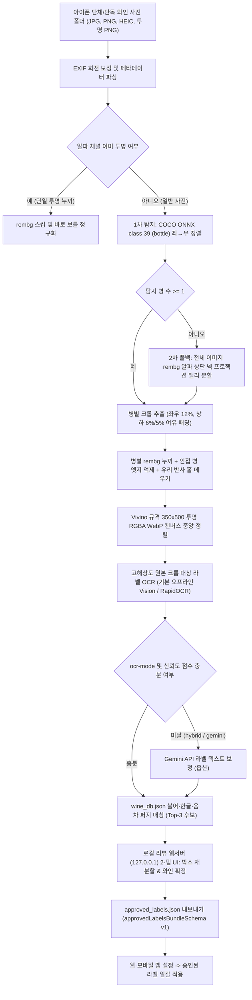

# SPEC: 다중 와인 보틀 누끼 분할 & OCR 매칭 도구 (`SPEC_BOTTLE_CUTOUT`)

> **상태:** Phase 1 구현 및 단위·통합 테스트 검증 완료 (Phase 2 iOS 네이티브 연동은 향후 작업)  
> **범위:** Phase 1 (Mac/PC 단독 로컬 스크립트 + 리뷰 UI) / Phase 2 (iOS 네이티브 `BottleCutoutPlugin` 청사진)  
> **원칙:** 기존 웹·모바일 앱 코드(`src/`, `ios/`, `android/`) 무수정 상태에서 `approved_labels.json` 포맷으로 무결성 연동

---

## 0. 핵심 요약 및 사전 검증 결과

| 항목 | 결정 사항 | 비고 |
| :--- | :--- | :--- |
| **앱 연동 타겟** | 대표 와인 썸네일 (`wine.labelImageFileId`) | 기존 `설정 → 승인된 라벨 일괄 적용` (`approvedLabelsBundleSchema`, `schemaVersion: 1`) 그대로 활용 |
| **최종 출력 규격** | `350×500` (2:3, 비 비율 `0.700`) 투명 RGBA WebP | `WineThumbnail.tsx` `md`(`w-[52px] h-[74px]`, `0.703`) 배경 그라디언트 위에 누끼 보틀이 자연스럽게 부유 |
| **다병 분할 처리** | 1장에 세워진 `1~15`병 자동 좌→우 분할 + 인접 병 엣지 억제 | COCO ONNX `class_id == 39` (`bottle`) 1차 탐지 + 알파 상단 프로젝션 밸리 2차 폴백 + 리뷰 UI 수동 박스 조정(`/api/recut`) |
| **배경 제거 엔진** | Python `rembg` (`isnet-general-use`, 선택 `birefnet-general-lite`) | 입력이 이미 투명 알파 채널을 가지면(iPhone 단축어 사전 누끼 등) `rembg` 자동 스킵 |
| **OCR 하이브리드 (1-B)** | 기본 무료 오프라인(`macOS Vision` / Windows `rapidocr-onnxruntime`) + 선택 Gemini 폴백 | `--ocr-mode local\|hybrid\|gemini`, 신뢰도 낮거나 필기체 라벨만 선택적으로 Gemini Flash 보정 |
| **대용량 자동 선별·배치** | `--prefilter` / `--prefilter-only`, `--batch-size N --batch-index K`, `--skip-existing-labels` | `rembg` 전 YOLO 병 탐지·라플라시안 선명도·dHash 연사 중복 제거 + 다병 단체샷 우선 정렬 + `prefilter_cache.json` 재사용 |
| **Phase 2 확장성** | iOS 네이티브 `BottleCutoutPlugin.swift` 동일 출력 규격 공유 | `350×500` 투명 WebP & `VNRecognizeTextRequest` 파싱 규칙 재사용 |

### Intel Mac 환경 실측 제약 (`macOS 26.7.3`, `x86_64`)

명세 확정 전 실제 개발 머신에서 Swift Vision API 및 Python 런타임을 테스트해 아래 제약을 확인했다.

1. **`VNGenerateForegroundInstanceMaskRequest` 미지원 (Intel Mac):**  
   테스트 시 `Error Domain=com.apple.Vision Code=16 "VNGenerateForegroundInstanceMaskRequest does not support VNGenerateForegroundInstanceMaskRequestRevision1"` 반환. Intel Mac에는 Apple Neural Engine이 없어 macOS 네이티브 피사체 누끼 API가 동작하지 않는다.  
   → **해결:** Phase 1 배경 제거는 크로스 플랫폼 Python `rembg` (`onnxruntime` 기반)로 고정하고, `VNGenerateForegroundInstanceMaskRequest`는 Apple Silicon 기반 Phase 2 iOS(iOS 27 등 실기기) 전용으로 분리한다.
2. **`VNRecognizeTextRequest` 정상 동작 (Intel Mac):**  
   `fr-FR`, `en-US`, `it-IT`, `de-DE`, `es-ES`, `ko-KR` 및 `.accurate` 레벨에서 `"Château Margaux"` 등 악센트/불문/한글 인식 정상 동작 확인.  
   → **해결:** Phase 1 Mac 환경에서는 컴파일된 Swift 헬퍼(`scripts/mac_vision_ocr.swift`)를 기본 무료 오프라인 OCR로 사용하고, Windows/Linux에서는 `rapidocr-onnxruntime`으로 자동 폴백한다.
3. **Python 3.12 가상환경 분리:**  
   시스템 Python(`/usr/bin/python3`, 3.9.6) 대신 `/opt/anaconda3/bin/python3.12` 기반 전용 가상환경(`scripts/.venv_cutout`)을 사용해 `rembg`, `onnxruntime`, `Pillow`, `scipy`, `numpy` 의존성을 격리한다. Intel Mac(`x86_64`)에서는 `llvmlite>=0.46`/`numba>=0.63`의 macOS x86_64 프리빌트 휠 미제공으로 인한 소스 빌드 오류를 피하기 위해 `scripts/requirements_cutout.txt`에 `numba<0.63` · `llvmlite<0.46` 환경 마커를 고정한다.

### Public 저장소 보안 가드레일

- 본 명세서 및 향후 코드/커밋에는 실제 개인 와인 DB(`wine_db*.json`), 개인 사진, OAuth Client ID, Gemini API 키, 로컬 절대 사용자 데이터 경로 등을 절대 포함하지 않는다.
- Gemini 폴백 사용 시 API 키는 CLI 인자(`--gemini-key`) 또는 환경변수(`GEMINI_API_KEY`, `.env` gitignore 대상)로만 주입한다.
- 리뷰 서버는 반드시 `127.0.0.1` 루프백에만 바인딩하고, 생성 산출물(`scripts/cutout_work/`, `approved_labels*.json`, `wine_db*.json`)은 `.gitignore`로 차단한다.

---

## 1. 전체 아키텍처 (Phase 1 & Phase 2 흐름)



---

## 2. 다중 와인 보틀 분할 및 Vivino 규격 정규화 설계

### 2.1 입력 전처리 (EXIF & 포맷)

- 지원 입력 확장자: `.jpg`, `.jpeg`, `.png`, `.webp`, `.heic` / `.heif` (`pillow-heif` 설치 시 HEIC 직접 디코드, 미설치 시 Mac 내장 `sips -s format png` 임시 변환 폴백).
- 모든 입력 이미지는 `PIL.ImageOps.exif_transpose()`를 가장 먼저 적용해 세로/가로 촬영 방향을 정규화한다.
- 입력 RGBA 이미지에서 투명 픽셀(`alpha < 10`) 비율이 전체의 `15%` 이상이면 사용자가 iOS 단축어 등으로 이미 누끼를 딴 단일 보틀 이미지로 간주하여 객체 탐지·`rembg`를 스킵하고 2.4절의 `350×500` 정규화 단계로 직행한다.

### 2.2 3계층 다병 분할 전략 (Left-to-Right Splitting)

여러 병을 나란히 세워 놓고 찍은 사진에서 병마다 정확히 분리하고, 옆 병의 캡슐이나 라벨 끝자락이 섞이지 않도록 다음 3계층 파이프라인을 사용한다.

1. **1차 객체 탐지 (`BottleDetector` — COCO ONNX):**
   - PyTorch 없이 기존 `onnxruntime`만으로 실행되는 경량 COCO ONNX 모델(`yolov8s.onnx` 또는 `yolo11s.onnx`, 최초 실행 시 로컬 캐시 `~/.cache/jh_wine_forest/models/`로 다운로드 또는 `--yolo-model` 경로 지정)을 사용한다.
   - `class_id == 39` (`bottle`)만 채택하고 `class_id == 40` (`wine glass`)은 명시적으로 제외해 테이블 위 와인잔 오탐을 방지한다.
   - 필터링 규칙:
     - 신뢰도 `conf >= 0.28`
     - 종횡비 `height / width >= 1.4` (누워 있거나 정사각형에 가까운 배경 소품 배제)
     - 최소 높이 `height >= 0.18 * img_height` (배경 멀리의 소형 물체 배제)
     - **앞줄 주피사체 필터:** 사진 내 최장 병(`max_h >= 0.35 * img_height`)이 있을 때 높이 `< 0.55 * max_h`인 뒷줄 진열장 배경 병 자동 제외
     - 클래스 내 NMS(`IoU > 0.45` 제거) 및 **포함(Containment) 중복 제거**(큰 박스 안에 작은 박스의 `80%` 이상이 겹치면 작은 오탐 박스 제거)
   - 최대 15병 상한 적용 시 좌측 작은 병에 밀려 우측 큰 병이 잘리지 않도록 **면적(크기) 순 상위 15병을 먼저 선별한 뒤**, 최종 바운딩 박스를 중심 `x_center` 오름차순(좌 → 우)으로 정렬해 번호를 부여한다.

2. **2차 폴백 분할 (넥 프로젝션 밸리):**
   - 1차 탐지 결과가 0건이거나 사용자가 리뷰 UI에서 `[밸리 재분할]`을 요청한 경우 동작한다.
   - 전체 이미지에 1회 `rembg`를 수행해 전경 알파 마스크 `A(y, x)`를 얻는다.
   - 병목(Neck)이 명확히 드러나는 상단 스트립 `y ∈ [15%, 42%]` 구간에서 열(Column)별 전경 픽셀 합 `H(x)`를 계산하고 가우시안 스무딩(`sigma = max(3, img_width * 0.008)`)을 적용한다.
   - 인접 병과 병목 사이의 **극소점(Local Valley, `H(x) < 0.25 * global_peak`)**을 절단선 `x_split`으로 삼아 독립 세그먼트로 분리한다.

3. **병별 크롭 추출 및 인접 병 엣지 억제 (Neighbor Suppression):**
   - 각 탐지 박스 `[x1, y1, x2, y2]`에 대해 라벨·캡슐 잘림 방지를 위한 안전 패딩을 적용한다:
     - 좌우 `pad_x = 0.12 * box_w`, 상단 `pad_top = 0.06 * box_h`, 하단 `pad_bottom = 0.05 * box_h` (이미지 경계 클램핑).
   - 크롭 내부에서 `rembg` 수행 후, 옆 병의 일부가 패딩 영역에 걸려 들어오는 문제를 제거하기 위해 **연결 성분(Connected Component) 정제**를 수행한다:
     - `alpha > 128` 이진 마스크에서 `scipy.ndimage.label`로 연결 성분을 분리.
     - 크롭 중앙 코어 영역(`x ∈ [30%, 70%]`, `y ∈ [25%, 80%]`)을 포함하는 주(Main) 보틀 성분만 유지(또는 면적이 최대 성분의 `35%` 미만이고 경계에 접한 소형 성분 폐기).
     - 원래 탐지 박스 바깥 패딩 영역(`pad_x`)에서 갑작스럽게 나타나는 보조 피사체는 부드러운 거리 감쇠(Box Margin Taper)로 억제.
   - **불량 실루엣 & 0줄 OCR 게이트 (`is_valid_bottle_cutout`):** 비수동(`split_source != "manual"`) 누끼 결과가 `bw < 16` / `bh < 40` / `bh/bw < 1.60` / 채움 비율 `< 22%`이거나 로컬 OCR 인식 텍스트가 `0줄`인 경우 임시 파일을 삭제하고 자동 폐기한다. (`--auto-match-only` 지정 시 `50점` 미만 미매칭 병도 자동 폐기)
   - **유리 반사 홀 메우기 & 엣지 페더링:**
     - 투명/녹색 병의 강한 하이라이트로 생긴 내부 구멍을 `scipy.ndimage.binary_fill_holes`로 메워 배경이 뚫려 보이지 않게 처리한다.
     - 외곽 알파 경계에 `1px` 가우시안 페더링을 적용해 계단 현상(Aliasing)을 완화한다.

### 2.3 Vivino 스타일 `350×500` 투명 RGBA WebP 정규화

앱의 `WineThumbnail.tsx`는 다음과 같이 렌더링한다:
- `md` 썸네일 컨테이너: `w-[52px] h-[74px]` (비율 `52 / 74 ≈ 0.703`)
- `lg` 썸네일 컨테이너: `w-16 h-24` (비율 `64 / 96 ≈ 0.667`)
- 배경: 와인 색상(`accent`) 기반 방사형/선형 그라디언트 위에 ``가 `object-cover`로 올라간다.

따라서 최종 누끼 캔버스를 아래 규격으로 고정하면 앱 코드 수정 없이 모든 병이 균일한 크기로 깔끔하게 정렬된다:

- **캔버스 크기:** `350 × 500 px` (비율 `0.700`, RGBA 투명 배경 `(0, 0, 0, 0)`)
- **타이트 바운딩 박스 기준 리사이즈:** 알파 `> 10` 픽셀의 최소 외접 사각형을 구한 뒤, 캔버스 내 가용 영역(`width <= 300px`, `height <= 450px` — 상하좌우 약 `5~7%` 여백)에 비율 유지 리사이징(`Image.Resampling.LANCZOS`).
- **배치 정렬:** 가로 정중앙(`x = (350 - new_w) // 2`), 세로 하단 기준 약간 위(`y = 500 - 24 - new_h`, 즉 하단 여백 `24px` 고정, 만약 `new_h > 452`면 상하 균등 배치)로 놓아 병 바닥 라인이 리스트 카드에서 일정하게 맞춰지도록 한다.
- **인코딩:** WebP 무손실/고품질 알파 모드 (`lossless=False, quality=88, method=6` 또는 파일 크기 `> 90KB`일 때 `quality=82`로 자동 조정). `src/services/media/imageProcessor.ts`의 `dataUrlToBlob`이 `data:image/webp;base64,...`를 그대로 `Blob`으로 변환하므로 100% 호환된다.

---

## 3. 하이브리드 1-B OCR 및 `wine_db.json` 퍼지 매칭

### 3.1 OCR 입력 크롭 전략

- **중요:** OCR은 `350×500` 축소본이 아닌 **원본 고해상도 병 크롭(`orig_crop`)**에 수행해야 작은 샴페인 퀴베 명칭이나 빈티지 숫자(`2019`, `1er Cru`) 인식률이 유지된다.
- 병 크롭 전체와 함께 **라벨 집중 구간(`y ∈ [28%, 82%]`, `x ∈ [10%, 90%]`)**을 우선 OCR 대상으로 전달해 병목 호일 문자 오인식을 줄인다.

### 3.2 2단계 하이브리드 OCR 파이프라인 (`--ocr-mode`)

1. **기본 무료 오프라인 엔진 (`local`):**
   - **macOS:** `scripts/mac_vision_ocr.swift`를 최초 1회 `~/.cache/jh_wine_forest/mac_vision_ocr` 바이너리로 `swiftc -O` 컴파일한 뒤, 이미지 경로 배열을 JSON 인자로 넘겨 배치 실행한다.
     - 설정: `VNRecognizeTextRequest`, `recognitionLevel = .accurate`, `usesLanguageCorrection = true`, `recognitionLanguages = ["fr-FR", "en-US", "it-IT", "de-DE", "es-ES", "ko-KR"]`.
     - 출력 JSON: `[{ "path": "...", "lines": [{ "text": "...", "confidence": 0.92, "y": 0.45 }] }]`.
   - **Windows / Linux 폴백:** `rapidocr-onnxruntime`으로 동일 JSON 스키마를 생성한다.
2. **선택적 Gemini 보정 (`hybrid` / `gemini`):**
   - `--ocr-mode local` (기본값): 외부 네트워크 호출 0회, 완전 오프라인 무료.
   - `--ocr-mode hybrid`: 로컬 OCR 결과에서 (a) 인식된 유효 라인이 2줄 미만이거나, (b) 평균 confidence `< 0.55`이거나, (c) DB 매칭 Top-1 점수가 `< 62점`인 병만 선택해 Gemini Flash (`gemini-2.5-flash` 또는 지정 모델)에 라벨 텍스트/와인명·빈티지 구조화 JSON 추출을 요청한다.
   - `--ocr-mode gemini`: 모든 병을 Gemini API로 직접 판독.

### 3.3 `wine_db.json` 다국어/음차 퍼지 매칭 로직

`wine_db.json` 내 와인은 영문·불문·한글 혼용(`예: "Château Margaux"`, `"샤또 마고"`, `"Domaine de la Romanée-Conti"`)이므로, 기존 `scripts/label_review_tool.py`의 `normalize_group_name` 개념을 확장해 아래 정규화 및 가중치 점수를 적용한다.

- **텍스트 정규화:**
  - 유니코드 악센트 제거 (`NFD` → Combining Mark 제거: `é → e`, `ô → o`, `ü → u`).
  - 소문자화 및 특수문자/구분자(`'`, `-`, `.`) 공백 치환.
  - **와인 불어/이태리어/한글 도메인 토큰 사전 치환 (Bidirectional Alias Expansion):**
    - `chateau / ch. / 샤또 / 샤토` ↔ `chateau`
    - `domaine / dom. / 도멘` ↔ `domaine`
    - `clos / 끌로 / 클로` ↔ `clos`
    - `saint / st / 생` ↔ `saint`
    - `premier cru / 1er cru` ↔ `1er cru`, `grand cru / 그랑 크뤼` ↔ `grand cru`
    - 주요 생산자/아펠라시옹 음차 보조 매핑(예: `bordeaux/보르도`, `bourgogne/burgundy/부르고뉴`, `champagne/샴페인`, `margaux/마고`, `pauillac/뽀이약`).
- **와인 스코어링 (0 ~ 100점):**
  - 토큰 자카드 유사도 + 부분 문자열(`difflib.SequenceMatcher` / `token_set_ratio`) 가중 결합 (`75%`)
  - **고유 와인명 토큰 검증 (`GENERIC_WINE_TERMS`):** `Chardonnay`, `Pinot Noir`, `Cabernet`, `Brut`, `Reserve` 등 일반 품종·등급어만 겹치고 생산자/고유명/세부 아펠라시옹 토큰이 전혀 일치하지 않으면 점수를 `25점` 이하로 제한해 가짜 매칭을 차단한다.
  - OCR에서 4자리 연도(`1950~2030`)가 추출되고 `wine.vintage`와 일치하면 `+15점`, 불일치(둘 다 빈티지 존재) 시 `-10점`
  - 와인 색상 힌트(라벨 키워드 `Blanc/Brut/Chardonnay` vs `Rouge/Cabernet/Pinot Noir` 또는 병 유리색 휴리스틱) 일치 시 `+10점`
- **산출:** 각 병마다 **Top-3 후보 와인** + 매칭 점수 + `vintage` 무관 그룹 매핑(`wineIds` 배열 — 동일 와인명·색상의 다른 빈티지도 함께 연결 가능, 리뷰 UI에서 토글 선택)을 생성한다.

---

## 4. 로컬 리뷰 서버 & `approved_labels.json` 연동

### 4.1 4-탭 로컬 리뷰 UI (`http://127.0.0.1:<port>`)

`scripts/bottle_cutout_tool.py` 실행 시 로컬 HTTP 서버가 열리고 브라우저에서 아래 4개 탭을 제공한다. (`--serve-only` 지정 시 재누끼/OCR 없이 기존 `session.json`만 1초 만에 불러와 서버를 바로 열며, `--unlabeled-first` 지정 시 탭 4로 즉시 진입한다.)

1. **탭 1 — 사진별 병 분할 점검/재컷팅 (`/api/boxes`, `/api/recut`):**
   - 좌측: **사진 파일명 검색** + 원본 사진 목록. 우측: 원본 사진 캔버스 위에 탐지된 모든 병의 바운딩 박스 `[x1, y1, x2, y2]`를 좌→우 번호(`#1`, `#2`...)와 함께 오버레이.
   - 조작 기능:
     - 박스 드래그/리사이즈로 겹친 병 경계 수동 조정 (조작 즉시 `POST /api/boxes`로 `session.json` 자동 저장)
     - `[+ 병 박스 추가]` 클릭으로 미탐지 병 추가, `[삭제]` 또는 키보드 `Delete`/`Backspace`로 오탐 박스 제거
     - `[밸리 재분할 실행]` 버튼으로 2차 폴백 분할 즉시 재시도
     - `[이 사진 재누끼 및 OCR 다시 실행]` 클릭 시 `POST /api/recut` 호출 → 서버가 해당 사진만 즉시 재컷팅·재누끼·재OCR하여 결과 반영 (0개 박스로 전체 비우기도 지원)
     - **원본 1단계 수동 누끼 왕복 배너:** 탭 2·탭 4·전체 갤러리·확대 라이트박스에서 `[✂️ 1단계 수동누끼]`를 눌러 진입한 경우 상단 작업 배너가 표시되며, 재누끼 완료 즉시 새로 잘린 컷마다 `[이 새 누끼 적용 & 복귀]` 원클릭 버튼과 `[← 돌아가기]`를 제공한다.
2. **탭 2 — 누끼 보틀 & 와인 DB 매칭 확정 (기본 진입 탭):**
   - 기본 뷰: 보틀이 1개 이상 있으면 브라우저 접속 시 탭 2로 자동 진입하며, **`매칭 후보만 (50점+ / 확정)`** · **`50점+ 미확정만`** 필터 + **`와인별 베스트 1장만 보기`** 체크박스 기본 활성 + **`[현재 화면 미결정 일괄 확정]`**(`POST /api/bulk-approve`, 기존 확정/제외 유지) + 서버 측 동일 와인 자동 중복 정리(`deduplicate_best_approved_per_wine`) 및 `10장` 단위 체크포인트 저장을 제공한다. (원할 때 `전체 보기` 전환 가능)
   - 카드 그리드: 각 병마다 **어두운/컬러 그라디언트 배경 미리보기(실제 앱 카드와 동일 배경)** 위에 `350×500` 누끼 이미지를 렌더링해 외곽 잔여 노이즈나 인접 병 찌꺼기를 한눈에 확인하며, 썸네일 클릭 시 **확대 라이트박스(누끼 ↔ 원본 라벨 크롭 전환 · 1단계 수동누끼 점프)**를 띄워 라벨 글씨·빈티지를 크게 판독할 수 있다.
   - 우측 패널: OCR 추출 원문, 추천 Top-3 와인(점수 표시), **120개 제한 없는 전체 `wine_db.json` 실시간 검색**(악센트 제거 + 국가/지역/세부지역 매칭 + 건수 표시), **"동일 와인(다른 빈티지 포함) 일괄 적용"** 체크박스, `[확정]` / `[보류]` / `[제외]` / `[✂️ 1단계 수동누끼]` 버튼(클릭 즉시 `session.json` 저장).
3. **탭 3 — 중복 와인 대표 고르기 (`/api/select-representative`, `/api/exclude-group`):**
   - 같은 와인(`selectedGroupKey`)에 속한 보틀이 `2장 이상`인 와인만 모아 **와인당 가로 1줄**로 나란히 비교한다.
   - 원하는 컷에서 대표 선택 버튼을 누르면 확인 팝업 후 해당 1장만 단독 `approved` (`representativeConfirmed: true`)로 고정되고 나머지 중복 컷은 자동 `excluded` 처리되며, 잘못 고른 와인은 `[모두 선택안함 (중복에서 삭제)]`로 전체 `excluded` 처리해 목록에서 즉시 제거할 수 있다. 완료/제외된 와인은 기본 체크(`대표 확정 완료된 와인 숨기기`)에 의해 탭 3 작업 목록에서 즉시 정리된다.
4. **탭 4 — 라벨 없는 와인 역방향 매칭 (`/api/unlabeled-plan`, `/api/unlabeled-assign`, `/api/export-unlabeled`):**
   - **대상 필터:** 최신 `wine_db.json`에서 `labelImageFileId`가 비어 있는 와인만 `(와인명, 색상)` 단위로 표시하며, `보유 중(IN_STOCK)만 보기`(기본 ON), `미배정 와인만 보기`, `추천에 이미 사용된 누끼 포함`, 와인명/생산자/산지 검색을 제공한다.
   - **확장 가능한 누끼 풀 & 보충 계획 구조:** `build_cutout_pool()`이 `session["photos"]`와 예약 확장 슬롯 `session["poolExtensions"]`를 단일 풀로 통합하며, `plan_unmatched_backfill_targets()`가 `prefilter_cache.json` 대비 미수집 `<50점` YOLO 박스 수를 산출해 추후 50점 미만 보충 누끼 생성 옵션과 API/UI 변경 없이 바로 결합되도록 설계했다.
   - **1순위 — 와인별 역방향 추천 Top-6 (`score_reverse_cutout_match`):** 라벨 없는 와인의 이름·생산자·산지 토큰과 기존 누끼 OCR을 역방향 재스코어링(부분 유사도·빈티지·색상 반영, 일반 품종어 단독 일치 `<= 35점` 상한)하여 가로 스트립으로 추천하고 `[이 누끼 확정]` / `[✂️ 1단계 수동누끼]` / 라이트박스 비교를 제공한다.
   - **2순위 — 전체 누끼에서 고르기 모달:** `[전체 누끼에서 고르기]` 클릭 시 OCR 텍스트·파일명 검색, `미사용 누끼만 보기`, 추천순/파일명순/용량순 정렬, 48장 페이지네이션 갤러리를 띄워 누끼 풀 전체에서 직접 선택하거나 1단계 수동 누끼로 연결한다.
   - **부가 편의 업로드 (`encode_manual_label_webp`):** 각 카드 좌측에서 이미지 드래그&드롭, 파일 선택, 클립보드 `Cmd+V`(또는 `📋 붙여넣기`)로 받은 이미지를 서버에서 최대 `500px` WebP로 자동 압축해 배정한다. 배정이 완료된 와인은 **입력 순서(`updatedAt` 오름차순)대로 목록 맨 아래로 자동 이동**하며 다음 미배정 와인이 자동 선택되어 연속 입력이 매끄럽게 이어진다.
   - **2차 전용 내보내기:** `[라벨 없는 와인 매칭분만 내보내기]` 클릭 시 탭 2·3의 기적용 항목을 제외하고 탭 4 배정분만 `*_unlabeled.json` (`approvedLabelsBundleSchema` v1)으로 내보낸다.
- 상단 툴바: `[중간 저장 (session.json)]`, `[approved_labels.json 내보내기]`.
- **전 단계 공통 편의 기능:** 탭 1(수동 누끼 배너)·탭 2(선택/추천 후보)·탭 3(중복 그룹 제목)·탭 4(와인 카드 제목)·전체 누끼 갤러리 모달·확대 라이트박스의 모든 와인명(`.copyable-wine-name`)을 클릭하면 색상/빈티지 없이 **순수 와인 이름만** 클립보드에 자동 복사(`copyWineNameOnly`)되며 하단 토스트로 즉시 확인된다.

### 4.2 출력 JSON 계약 (`src/types/validation.ts` 100% 일치)

`src/types/validation.ts`의 `approvedLabelsBundleSchema` & `approvedLabelItemSchema`를 그대로 준수해 앱 코드를 한 줄도 바꾸지 않고 즉시 임포트할 수 있다.

```json
{
  "schemaVersion": 1,
  "generatedAt": "2026-11-27T08:00:00.000Z",
  "items": [
    {
      "wineId": "wine-uuid-primary",
      "wineIds": ["wine-uuid-primary", "wine-uuid-other-vintage"],
      "wineName": "Chateau Example",
      "color": "R",
      "vintage": "2019",
      "mimeType": "image/webp",
      "dataUrl": "data:image/webp;base64,UklGR..."
    }
  ]
}
```

- 검증 조건:
  - `schemaVersion`은 정수 `1`
  - `items` 각 항목의 `wineId`는 비어 있지 않은 문자열
  - `dataUrl`은 반드시 `data:image/webp;base64,`로 시작 (`/^data:image\//` 및 `;base64,` 포함 검사 통과)
  - 선택 필드 `color`는 `wine_db.json`의 유효 `WineColor`(`R | W | SP | SW | RO`) 값만 사용

### 4.3 CLI 인터페이스 설계

```bash
# 1. 전용 가상환경 및 macOS Vision 헬퍼 초기화
/opt/anaconda3/bin/python3.12 -m venv scripts/.venv_cutout
scripts/.venv_cutout/bin/pip install -r scripts/requirements_cutout.txt

# 2. 기본 실행 (무료 오프라인 OCR + 다병 자동 분할 + 로컬 리뷰 서버)
scripts/.venv_cutout/bin/python scripts/bottle_cutout_tool.py \
  --photos ./raw_photos \
  --db ./wine_db.json \
  --out ./approved_labels.json

# 3. 하이브리드 OCR + 고품질 모델 + 재개 실행
GEMINI_API_KEY="***" scripts/.venv_cutout/bin/python scripts/bottle_cutout_tool.py \
  --photos ./raw_photos \
  --db ./wine_db.json \
  --out ./approved_labels.json \
  --ocr-mode hybrid \
  --rembg-model birefnet-general-lite \
  --resume ./scripts/cutout_work/session.json

# 4. 대량 사진(예: 800장) 빠른 사전 선별 및 배치 분할 실행
scripts/.venv_cutout/bin/python scripts/bottle_cutout_tool.py \
  --photos ./raw_photos \
  --db ./wine_db.json \
  --prefilter-only

scripts/.venv_cutout/bin/python scripts/bottle_cutout_tool.py \
  --photos ./raw_photos \
  --db ./wine_db.json \
  --out ./approved_labels_b1.json \
  --prefilter \
  --skip-existing-labels \
  --auto-match-only \
  --batch-size 40 \
  --batch-index 1

# 5. 기존 session.json 즉시 재실행 (재누끼/OCR 없이 리뷰 서버만 띄우기; 탭 4 바로 열기는 --unlabeled-first 추가)
scripts/.venv_cutout/bin/python scripts/bottle_cutout_tool.py \
  --db ./wine_db.json \
  --out ./approved_labels.json \
  --serve-only \
  --unlabeled-first \
  --resume ./scripts/cutout_work/session.json

# 6. 헤드리스 배치 (테스트/자동화용, 리뷰 서버 없이 중간 산출물만 생성)
scripts/.venv_cutout/bin/python scripts/bottle_cutout_tool.py \
  --photos ./raw_photos \
  --db ./wine_db.json \
  --no-server
```

---

## 5. Phase 2 청사진: iOS 네이티브 `BottleCutoutPlugin` 확장

Phase 1 단독 스크립트 검증 후 앱 내부 사진 업로드 흐름(`src/services/media/photoPicker.ts`)에 통합할 때의 구조다. (본 Phase 1 작업에서는 구현하지 않는다.)

1. **네이티브 플러그인 (`ios/App/App/Plugins/BottleCutoutPlugin.swift`):**
   - `PHPickerViewController`로 사진 선택 (단일 또는 다중 병 사진).
   - **Apple Silicon 실기기 전용** `VNGenerateForegroundInstanceMaskRequest` 실행:
     - `observation.allInstances`로 전경 인스턴스 마스크를 분리하고, 다중 병이 각각 별도 인스턴스로 인식되면 좌→우 정렬해 병 선택/일괄 추출 UI 제공.
     - `VNGenerateForegroundInstanceMaskRequest`가 지원되지 않는 구형/시뮬레이터 환경에서는 원본 크롭으로 우아하게 폴백.
   - Phase 1과 완전히 동일한 `350×500` 투명 RGBA 캔버스 정규화 + WebP(또는 iOS 네이티브 WebP 인코더/PNG→JS `imageProcessor` WebP 변환) 반환.
   - `VNRecognizeTextRequest` 결과를 JS로 함께 전달해 와인 추가/수정 화면 자동 매칭에 활용.
2. **웹/TS 연동 (`src/services/media/photoPicker.ts`):**
   - `PickImageOptions`에 `cutout?: boolean` (기본 `false`) 옵션만 추가.
   - `Capacitor.isNativePlatform() && Capacitor.getPlatform() === 'ios' && options.cutout`일 때만 `BottleCutoutPlugin` 호출, 웹/Android에서는 기존 `pickImageFile` 경로를 100% 그대로 유지.

---

## 6. Phase 1 구현 파일 목록 및 완료 기준 (DoD)

### 6.1 신규/수정 예정 파일 (Phase 1 구현 단계에서 생성)

| 파일 | 역할 |
| :--- | :--- |
| `scripts/bottle_cutout_tool.py` | 다병 탐지/밸리 폴백 분할, 인접 엣지 억제 `rembg`, `350×500` 투명 WebP 정규화, OCR & 퍼지 매칭, `127.0.0.1` 리뷰 서버 + CLI |
| `scripts/mac_vision_ocr.swift` | macOS `VNRecognizeTextRequest` 배치 OCR CLI 헬퍼 (자동 컴파일 캐시 지원) |
| `scripts/requirements_cutout.txt` | `rembg`, `onnxruntime`, `Pillow`, `numpy`, `scipy`, `pillow-heif`, `rapidocr-onnxruntime` (Windows/Linux 조건부) |
| `.gitignore` | `scripts/.venv_cutout/`, `scripts/cutout_work/`, `raw_photos/`, `*.onnx` 캐시 등 민감·대용량 산출물 추가 차단 |
| `tests/test_bottle_cutout.py` | `unittest` 기반 순수 단위 테스트 (다병 합성 이미지 분할, 인접 엣지 억제, `350×500` RGBA WebP 캔버스 비율/하단 정렬, 불어/한글 퍼지 매칭, `approved_labels.json` 스키마 검증, `/api/recut` 핸들러) |

### 6.2 Phase 1 완료 검증 기준 (Definition of Done)

- [x] `scripts/.venv_cutout/bin/python -m unittest -v tests/test_bottle_cutout.py` 전체 19개 단위·통합 테스트 통과 (합성 다병 분할, 앞줄 주피사체/YOLO/밸리 필터, 불량 실루엣 `>= 1.6` & 0줄 OCR 자동 폐기, `--auto-match-only`, 인접 엣지 억제, `350×500` RGBA WebP, 고유 와인명 검증 포함 불어·한글 퍼지 매칭, 서버 측 와인별 베스트 1장 선정·중복 제거, `approved_labels.json` 스키마 v1, `/api/boxes`·0개 박스 `/api/recut`·`/api/bulk-approve`·`/api/select-representative`·`--serve-only`, 확장형 누끼 풀 & `<50점` 보충 타겟 산출, 탭 4 역방향 추천/전체 갤러리/`Cmd+V` WebP 업로드/1단계 수동누끼 왕복/`--unlabeled-first`·`*_unlabeled.json` 내보내기 포함, 실시간 `mac_vision_ocr.swift` OCR, 사전 선별 YOLO/선명도/dHash 중복 제거 및 캐시, 배치 슬라이싱·기존 라벨 제외 포함).
- [x] `npm run typecheck`, `npm run test` (9 suites / 69 tests), `npm run build` 기존 웹 테스트·빌드 무영향(`0` 회귀).
- [ ] 실제 아이폰 다병 사진(2~6병) 샘플 입력 시 좌→우 순서로 `350×500` 투명 WebP(`data:image/webp;base64,...`) 생성 및 인접 병 침범 없음 확인 (`scripts/.venv_cutout` 설치 후 실사진 검수 단계에서 최종 확인).
- [ ] 실사진으로 생성한 `approved_labels.json`을 앱 `[설정 → 승인된 라벨 일괄 적용]`에 업로드했을 때 Zod(`approvedLabelsBundleSchema`) 검증 통과 및 `WineThumbnail`에서 배경 그라디언트 위 투명 보틀 실렌더링 확인 (번들 스키마 계약 테스트는 완료).
- [x] `git status -uall --short` 상 개인 와인 DB·사진·가상환경·API 키가 추적 대상에 포함되지 않음 확인.
