# JH Wine Forest — 무서버 읽기 전용 와인 리스트 공유 링크 작업지시서 (`SPEC_SHARE_LINK.md`)

> **문서 안내:** 본 문서는 AI 및 개발자가 추가 추측 없이 바로 구현·검증할 수 있도록 작성된 **초경량 무서버 읽기 전용 공유 링크 (`#/share?d=...`)** 상세 작업지시서입니다.
> - **상태:** **COMPLETED — 구현 및 검증 완료 (`npm run typecheck` · `npm run test` 9 suites / 69 tests · `npm run build` · `npm run build:mobile` 통과)**
> - **연관 문서:** [SPEC_1_UI_ARCH.md](./SPEC_1_UI_ARCH.md) · [SPEC_2_DATA_EXEC.md](./SPEC_2_DATA_EXEC.md) · [IMPLEMENTATION_PLAN.md](./IMPLEMENTATION_PLAN.md) · [SPEC_MOBILE_IOS.md](./SPEC_MOBILE_IOS.md)
> - **구현 원칙:** 기존 `JH Wine Forest` 웹앱(GitHub Pages PWA) 및 iOS/Android Capacitor 앱과 100% 호환되며, 외부 서버·유료 인프라·추가 npm 패키지 없이 동작합니다.

---

## 0. 확정 의사결정 요약 및 AI Guardrails

### 0.1 확정 사양 요약표

| 항목 | 확정 내용 | 비고 |
| :--- | :--- | :--- |
| **기능 범위** | **기능 2 단독 구현** (필터링/전체 와인 리스트 읽기 전용 공유) | 기능 1(타 구글 계정 DB 접속)은 본 스펙 범위 외 |
| **공유 방식** | **초경량 무서버 URL 해시 압축 스냅샷** (`#/share?d=<token>`) + **텍스트 목록 복사** 병행 | 공유 시점 고정 스냅샷 (원격 DB 비연동) |
| **외부 인프라 · 패키지** | **0개** (백엔드/KV/추가 npm 의존성 미사용) | 브라우저 표준 `CompressionStream('deflate-raw')` + 기존 `zod` 활용 |
| **공개 공유 Base URL** | `https://jihoon2-jung.github.io/wine-forest/` | `VITE_PUBLIC_SHARE_URL` 환경변수로 오버라이드 가능 |
| **라벨 · 시음 사진** | **미포함** (텍스트 메타데이터 중심 경량 공유) | `labelImageFileId`, `photoFileIds` 제외 |
| **프라이버시 기본값** | 가격·환율메모 / 구입처·구입일 / 병 메모 / 셀러 보관 위치 **4종 모두 기본 OFF** | 체크 해제 시 인코딩 페이로드에서 키 자체 원천 제거 |
| **만료 정책** | **소프트 만료일 옵션** (`제한 없음(기본)` · `7일` · `30일`) | 화면 열람 차단용 UI 가림(원격 파기·회수 불가함을 UI에 명확히 고지) |
| **수신자 환경** | **Google 로그인·IndexedDB·로컬 DB 없이 즉시 열람** | 카카오톡/문자 인앱 브라우저, 모바일·데스크톱 브라우저 |

### 0.2 절대 준수 제약 (AI Guardrails)

구현 에이전트는 작업 전후로 아래 5가지 제약을 반드시 지켜야 합니다.

1. **`wine_db.json` 스키마 및 동기화 무변경:** [schema.ts](../src/types/schema.ts)(`schemaVersion: 1`), [validation.ts](../src/types/validation.ts), [googleDriveAdapter.ts](../src/services/storage/googleDriveAdapter.ts), [syncEngine.ts](../src/services/storage/syncEngine.ts)는 수정하지 않습니다.
2. **Android / `win-android` 코드 생성 금지:** 이 Mac 워크스페이스에서는 `android/`, `@capacitor/android`, `@capacitor/app`, `cap:*:android` 등 Android 관련 파일·패키지를 절대 생성하거나 설치하지 않습니다.
3. **`/share` 진입 시 로컬 상태·인증 무오염:** 수신자가 `#/share?d=...`를 열거나 소유자가 미리보기를 실행할 때 IndexedDB(`appState`, `localBackups`, `photoCache`), `useWineStore.db`, `fileId`, Google Auth 토큰 상태를 **단 1바이트도 변경하거나 로그인 팝업을 호출하지 않습니다.**
4. **XSS 및 DOM 인젝션 원천 차단:** 공유 URL에서 디코딩한 모든 문자열(제목, 와인명, 생산자, 메모 등)은 순수 React JSX 텍스트 바인딩(`{value}`)으로만 렌더링하며, `dangerouslySetInnerHTML` 사용을 금지합니다.
5. **Public 저장소 보안 준수:** 테스트 데이터나 예시 코드에 개인 와인 목록·실제 OAuth Client ID·시크릿을 기재하지 않습니다.

---

## 1. 전체 아키텍처 & 데이터 흐름

```mermaid
flowchart LR
    INV["InventoryPage (현재 필터링된 WineGroupItem 목록)"] -->|"상단 [공유] 버튼 클릭"| MODAL["ShareListModal (제목·프라이버시·만료·길이 게이지)"]
    MODAL -->|"허용 필드만 추출 후 비공개 필드 원천 제거"| CODEC_ENC["shareCodec.ts (WireV1 -> deflate-raw -> Base64URL)"]
    CODEC_ENC -->|"웹/iOS 모두 GitHub Pages 공개 URL 생성"| SHARE_OUT["클립보드 복사 / OS 공유 시트 / 텍스트 목록 복사"]
    SHARE_OUT -->|"https://.../wine-forest/#/share?d=z.xxxx"| ROUTER["App.tsx (HashRouter 최상위 /share 무인증 분기)"]
    ROUTER -->|"isHydrated / !db 가드 우회"| PAGE["SharedListPage (로그인·IndexedDB 불필요)"]
    PAGE -->|"512KB 상한 + Zod 검증 + 소프트 만료 판정"| CODEC_DEC["decodeSharedPayload(d)"]
    CODEC_DEC -->|"읽기 전용 검색 · 색상 필터 · 정렬"| VIEW["수신자 전용 와인 리스트 카드/컴팩트 뷰"]
```



### 설계 핵심 포인트
- **발신(`InventoryPage` → `ShareListModal`):** 현재 화면에 표시 중인 `groups` (`WineGroupItem[]`)와 활성 필터 요약 문자열만 넘깁니다.
- **무인증 선분기(`App.tsx`):** `<HashRouter>`를 최상위로 올려 `/share` 경로가 `!isHydrated` 또는 `!db` (`OnboardingView`) 가드에 막히지 않게 합니다.
- **프라이버시 원천 차단(`shareCodec.ts`):** 해제된 옵션 필드는 UI에서 감추는 수준이 아니라 **와이어 페이로드 객체 생성 단계에서 아예 키를 만들지 않아**, 누군가 URL을 수동 디코딩해도 가격·구입처·메모·선반 위치를 알 수 없습니다.

---

## 2. 데이터 모델 · 컴팩트 와이어 포맷 v1 · 코덱 명세 (`src/services/share/shareCodec.ts`)

신규 파일 `src/services/share/shareCodec.ts`에 아래 상수, 타입, 직렬화·압축·검증·텍스트 포맷터 함수를 구현합니다.

### 2.1 Exported 상수 & TypeScript 타입

```typescript
import type { WineColor } from '@/types/schema';
import type { WineGroupItem } from '@/components/wines/WineGroupCard';

export const DEFAULT_PUBLIC_SHARE_BASE_URL = 'https://jihoon2-jung.github.io/wine-forest/';
export const SHARE_MAX_TOKEN_CHARS = 65_536;
export const SHARE_MAX_DECOMPRESSED_BYTES = 512 * 1024; // 512KB (Zip-bomb 방어)
export const SHARE_MAX_ITEMS = 2_000;
export const SHARE_URL_SAFE_MAX = 3_500;
export const SHARE_URL_WARN_MAX = 8_000;

export interface SharePrivacyOptions {
  includePrice: boolean;
  includeSourceAndDate: boolean;
  includeMemo: boolean;
  includeLocation: boolean;
}

export const DEFAULT_SHARE_PRIVACY_OPTIONS: SharePrivacyOptions = {
  includePrice: false,
  includeSourceAndDate: false,
  includeMemo: false,
  includeLocation: false,
};

export type ShareSoftExpiryOption = 'none' | '7d' | '30d';

export interface SharedWineItem {
  name: string;
  producer?: string;
  country: string;
  region: string;
  subRegion?: string;
  color: WineColor;
  vintage: string;
  bottleSizeMl: number;
  quantity: number;
  drinkingWindowStart?: number | null;
  drinkingWindowEnd?: number | null;
  // 아래 선택 필드는 옵션 ON일 때만 존재 (OFF 시 key 자체 미생성)
  avgPrice?: number;
  minPrice?: number;
  maxPrice?: number;
  isPriceUniform?: boolean;
  fxNote?: string;
  purchaseSource?: string;
  latestPurchaseDate?: string;
  memo?: string;
  locationSummary?: string;
}

export interface SharedWineListPayload {
  schemaVersion: 1;
  title: string;
  generatedAt: string; // 'YYYY-MM-DD'
  expiresAt?: string; // 'YYYY-MM-DD'
  filterSummary?: string;
  options: SharePrivacyOptions;
  items: SharedWineItem[];
}

export type ShareUrlLengthLevel = 'safe' | 'warning' | 'too_long';

export interface ShareUrlLengthEvaluation {
  length: number;
  level: ShareUrlLengthLevel;
  message: string;
}

export type DecodeShareErrorReason =
  | 'missing'
  | 'too_long'
  | 'unsupported_prefix'
  | 'corrupted_encoding'
  | 'decompression_limit'
  | 'invalid_schema';

export type DecodeShareResult =
  | {
      ok: true;
      payload: SharedWineListPayload;
      isExpired: boolean;
    }
  | {
      ok: false;
      reason: DecodeShareErrorReason;
      message: string;
    };
```

### 2.2 데이터 추출 규칙 (`buildSharedWinePayload`)

- **시그니처:**
  ```typescript
  export function buildSharedWinePayload(
    groups: WineGroupItem[],
    params: {
      title: string;
      filterSummary?: string;
      options: SharePrivacyOptions;
      expiry: ShareSoftExpiryOption;
      now?: Date;
    },
  ): SharedWineListPayload
  ```
- **입력 상한 방어:** `groups.slice(0, SHARE_MAX_ITEMS)`로 상한 적용.
- **제목 & 필터 요약:**
  - `title`: `params.title.trim().slice(0, 80) || 'JH Wine Forest 추천 리스트'`
  - `filterSummary`: `params.filterSummary?.trim().slice(0, 120) || undefined`
- **날짜 계산 (로컬 달력 기준 `YYYY-MM-DD`):**
  - [wineHelpers.ts](../src/services/domain/wineHelpers.ts)의 `getTodayIsoDate()`와 동일한 로컬 연/월/일 포맷 헬퍼 `formatLocalIsoDate(date: Date)`를 사용해 UTC 자정 어긋남(KST `+09:00` 1일 오차)을 방지합니다.
  - `generatedAt`: `formatLocalIsoDate(now)`
  - `expiresAt`:
    - `'7d'`: `now`에 로컬 7일(`setDate(date.getDate() + 7)`)을 더한 `YYYY-MM-DD`
    - `'30d'`: `now`에 로컬 30일(`setDate(date.getDate() + 30)`)을 더한 `YYYY-MM-DD`
    - `'none'`: `undefined`
- **와인 항목(`SharedWineItem`) 변환 규칙:**
  - `targetBottles = group.inStockBottles.length > 0 ? group.inStockBottles : group.allBottles`
  - `quantity = group.inStockBottles.length` *(품절 포함 공유 시 `0`이 되며 수신 화면에서 `품절` 배지 표시)*
  - 기본 필수 필드: `name`, `vintage`, `color`, `country`, `region`, `bottleSizeMl` (`wine.bottleSizeMl`), `quantity`
  - 기본 선택 필드: `producer`(trim 후 비어있지 않을 때), `subRegion`(trim 후 비어있지 않을 때), `drinkingWindowStart`, `drinkingWindowEnd`
  - **절대 포함 금지 필드:** `wine.id`, `bottle.id`, `labelImageFileId`, `photoFileIds`, `legacyRowNumber`, `tastingNote`, `companions`, `rating`, `includeInTrackingSince`
  - **프라이버시 옵션 4종 추출 규칙 (해제 시 키 자체를 추가하지 않음):**
    1. `options.includePrice === true`:
       - [statsCalculator.ts](../src/services/analytics/statsCalculator.ts)의 `calculateWineGroupPrice(targetBottles)`를 재사용해 `avgPrice`, `minPrice`, `maxPrice`, `isPriceUniform` 설정.
       - `fxNote`: `targetBottles`의 비어있지 않은 `fxNote.trim()`을 순서 유지 중복 제거(`Set`) 후 최대 3개 `' · '` 결합 → `.slice(0, 80)` (비어있으면 생략).
    2. `options.includeSourceAndDate === true`:
       - `purchaseSource`: `targetBottles`의 비어있지 않은 `purchaseSource.trim()`을 중복 제거 후 최대 3개 `' · '` 결합 → `.slice(0, 80)`.
       - `latestPurchaseDate`: `group.latestPurchaseDate && group.latestPurchaseDate !== '0000-00-00'`이면 설정 (단, `^\d{4}-\d{2}-\d{2}$` 매치 확인).
    3. `options.includeMemo === true`:
       - `memo`: `targetBottles`의 비어있지 않은 `memo.trim()`을 중복 제거 후 `' / '` 결합 → `.slice(0, 200)` (초과 시 말줄임 생략 없이 200자 절단).
    4. `options.includeLocation === true`:
       - `locationSummary`: `group.locationSummary && group.locationSummary !== '보유 없음'`이면 `.slice(0, 80)`으로 설정.

### 2.3 컴팩트 와이어 포맷 v1 (`WirePayloadV1`)

JSON 키 문자열(`"bottleSizeMl"`, `"country"` 등)의 반복을 없애 URL 길이를 30~50% 줄이기 위해, **사전(Dictionary) + 고정 위치 배열 튜플 + 옵션 비트마스크** 구조를 사용합니다.

#### 최상위 JSON 구조
```typescript
interface WirePayloadV1 {
  v: 1;
  t: string;      // title
  g: string;      // generatedAt ('YYYY-MM-DD')
  e?: string;     // expiresAt ('YYYY-MM-DD')
  f?: string;     // filterSummary
  o: number;      // 옵션 비트마스크 (0..15)
  c: string[];    // 국가 사전 (unique)
  r: string[];    // 지역 사전 (unique)
  w: WireWineTuple[];
}
```

#### 옵션 비트마스크 (`o`)
| 비트 값 | 플래그 | 의미 |
| :---: | :--- | :--- |
| `1` (`1 << 0`) | `FLAG_PRICE` | `includePrice` |
| `2` (`1 << 1`) | `FLAG_SOURCE_DATE` | `includeSourceAndDate` |
| `4` (`1 << 2`) | `FLAG_MEMO` | `includeMemo` |
| `8` (`1 << 3`) | `FLAG_LOCATION` | `includeLocation` |

#### 색상 인덱스 매핑
- `COLOR_TO_IDX: Record<WineColor, number> = { R: 0, W: 1, SP: 2, SW: 3, RO: 4 }`
- `IDX_TO_COLOR: readonly WineColor[] = ['R', 'W', 'SP', 'SW', 'RO']`

#### 와인 튜플 (`WireWineTuple`) 인덱스 표 (`0..18`)
없는 값/기본값은 숫자 `0`으로 넣고, 튜플 **뒤쪽의 연속된 `0` 원소는 `while (tuple.length > 6 && tuple[tuple.length - 1] === 0) tuple.pop()` 규칙으로 제거**합니다.

| 인덱스 | 필드명 | 인코딩 규칙 (인코딩 시) | 디코딩 규칙 (복원 시) |
| :---: | :--- | :--- | :--- |
| `0` | `name` | `string` (필수) | `string` |
| `1` | `vintage` | `string` (필수) | `string` |
| `2` | `colorIdx` | `0..4` (`COLOR_TO_IDX[color]`) | `IDX_TO_COLOR[val]` |
| `3` | `quantity` | `number` (0 이상 정수) | `number` |
| `4` | `countryIdx` | `c` 배열 인덱스 (0 이상 정수) | `c[val]` |
| `5` | `regionIdx` | `r` 배열 인덱스 (0 이상 정수) | `r[val]` |
| `6` | `subRegion` | 문자열 또는 `0` | `typeof val === 'string' && val ? val : undefined` |
| `7` | `producer` | 문자열 또는 `0` | `typeof val === 'string' && val ? val : undefined` |
| `8` | `bottleSizeMl` | `ml === 750 ? 0 : ml` | `typeof val === 'number' && val > 0 ? val : 750` |
| `9` | `drinkingWindowStart` | 정수 또는 `0` | `typeof val === 'number' ? val : null` |
| `10` | `drinkingWindowEnd` | 정수 또는 `0` | `typeof val === 'number' ? val : null` |
| `11` | `avgPrice` | `o & 1`일 때 정수(0 가능) / OFF면 `0` | `o & 1`이고 `typeof val === 'number'`이면 복원 |
| `12` | `minPrice` | `o & 1`일 때 정수 / OFF면 `0` | `o & 1`이고 `typeof val === 'number'`이면 복원 |
| `13` | `maxPrice` | `o & 1` && `!isPriceUniform`일 때 정수 / 같으면 `0` | `o & 1`이면 `typeof val === 'number' && val > 0 ? val : (minPrice ?? avgPrice)` |
| `14` | `fxNote` | `o & 1` && 존재 시 문자열 / 아니면 `0` | `o & 1`이고 `typeof val === 'string' && val`이면 복원 |
| `15` | `purchaseSource` | `o & 2` && 존재 시 문자열 / 아니면 `0` | `o & 2`이고 `typeof val === 'string' && val`이면 복원 |
| `16` | `latestPurchaseDate` | `o & 2` && 존재 시 문자열 / 아니면 `0` | `o & 2`이고 `typeof val === 'string' && val`이면 복원 |
| `17` | `memo` | `o & 4` && 존재 시 문자열 / 아니면 `0` | `o & 4`이고 `typeof val === 'string' && val`이면 복원 |
| `18` | `locationSummary` | `o & 8` && 존재 시 문자열 / 아니면 `0` | `o & 8`이고 `typeof val === 'string' && val`이면 복원 |

> **중요 (가격 0원 처리):** `includePrice`가 ON인데 가격이 `0`원인 병만 있는 경우, `[11]`(`avgPrice`)과 `[12]`(`minPrice`)에는 숫자 `0`이 들어가고 디코딩 시 `o & 1`이 참이면 `typeof val === 'number' ? val : 0`으로 복원되므로 trailing `0` 제거 후에도 `avgPrice: 0`이 정상 유지됩니다! (`isPriceUniform`은 `minPrice === maxPrice`로 복원)

### 2.4 압축 · Base64URL · 안전 디코딩 알고리즘

1. **Base64URL 헬퍼 (스택 오버플로 방지):**
   - `uint8ToBase64Url(bytes: Uint8Array): string`
     - `String.fromCharCode(...bytes)`를 **절대 사용하지 마십시오** (3만 바이트 초과 시 `RangeError: Maximum call stack size exceeded` 발생).
     - `0x2000` (8KB) 청크 루프로 `String.fromCharCode(...bytes.subarray(i, i + 0x2000))` 누적 후 `btoa(binary)` → `+`를 `-`, `/`를 `_`, 끝 `=` 제거.
   - `base64UrlToUint8(b64u: string): Uint8Array`
     - `^[A-Za-z0-9\-_]+$` 정규식 사전 검사 후 `-` → `+`, `_` → `/`, 4의 배수 패딩 `=` 복원 → `atob()` → `Uint8Array`.
2. **인코딩 (`encodeSharedPayload(payload: SharedWineListPayload): Promise<string>`):**
   - `wire = toWirePayloadV1(payload)` → `utf8Bytes = new TextEncoder().encode(JSON.stringify(wire))`
   - `typeof CompressionStream !== 'undefined'`가 지원되고 `deflate-raw` 생성이 성공하면:
     - `CompressionStream('deflate-raw')` 스트림으로 압축 → `readAllBytes(stream.readable)` → `return 'z.' + uint8ToBase64Url(compressedBytes)`
   - 미지원 환경이거나 `CompressionStream` 예외 시:
     - `return 'u.' + uint8ToBase64Url(utf8Bytes)` 폴백
3. **스트리밍 압축 해제 상한 (`decompressDeflateRawWithLimit`):**
   - `new Blob([compressedBytes])`를 쓰지 말고 `new ReadableStream({ start(c) { c.enqueue(compressedBytes); c.close(); } })` 또는 `Response`에 `DecompressionStream('deflate-raw')`를 파이프합니다.
   - `readable.getReader()` 루프로 청크를 읽으며 누적 `totalBytes += chunk.byteLength`를 체크합니다.
   - **`totalBytes > SHARE_MAX_DECOMPRESSED_BYTES` (512KB) 즉시 `await reader.cancel()` 후 `RangeError('DECOMPRESSION_LIMIT')` throw** → Zip-bomb 공격 메모리 고갈 방지.
4. **디코딩 (`decodeSharedPayload(rawToken: string | null | undefined, now?: Date): Promise<DecodeShareResult>`):**
   - 빈 값 → `{ ok: false, reason: 'missing', ... }`
   - `token.length > SHARE_MAX_TOKEN_CHARS` → `{ ok: false, reason: 'too_long', ... }`
   - 접두사 검사:
     - `'z.'` → `base64UrlToUint8` → `decompressDeflateRawWithLimit` (실패 시 `decompression_limit` 또는 `corrupted_encoding`)
     - `'u.'` → `base64UrlToUint8` (512KB 초과 시 `decompression_limit`)
     - 그 외 → `{ ok: false, reason: 'unsupported_prefix', ... }`
   - `JSON.parse(new TextDecoder('utf-8', { fatal: true }).decode(bytes))` → `wirePayloadV1Schema.safeParse(parsed)` 검증:
     - `v: z.literal(1)`
     - `t: z.string().min(1).max(120)`
     - `g: isoDateOnlySchema`, `e: isoDateOnlySchema.optional()`
     - `f: z.string().max(200).optional()`
     - `o: z.number().int().min(0).max(15)`
     - `c: z.array(z.string().min(1)).max(300)`
     - `r: z.array(z.string().min(1)).max(500)`
     - `w: z.array(z.array(z.union([z.string(), z.number()])).min(6).max(19)).max(SHARE_MAX_ITEMS)`
   - 튜플 복원 중 `colorIdx` 범위(`0..4`), `countryIdx < c.length`, `regionIdx < r.length`, `quantity >= 0` 추가 검증 후 실패 시 `{ ok: false, reason: 'invalid_schema', ... }` 반환.
   - **이중 프라이버시 강제 필터링:** 디코딩된 `WirePayloadV1`의 비트마스크 `o`가 OFF인 선택 필드는 튜플에 비정상 값이 들어 있어도 **복원하지 않고 버립니다.**
   - **소프트 만료 판정:**
     - `todayIso = formatLocalIsoDate(now ?? new Date())`
     - `isExpired = Boolean(payload.expiresAt && todayIso > payload.expiresAt)` *(만료일 당일까지는 열람 가능, 다음 날부터 만료)*

### 2.5 공개 URL 생성 · 길이 평가 · 텍스트 포맷터

1. **`getShareBaseUrl(): string`**
   - 1순위: `(import.meta.env.VITE_PUBLIC_SHARE_URL as string | undefined)?.trim()`이 비어있지 않으면 끝 `/` 정규화해 반환.
   - 2순위: `!Capacitor.isNativePlatform()`이고 `typeof window !== 'undefined'`이며 `window.location.protocol.startsWith('http')`이고 `window.location.hostname !== 'localhost'`이면 `${window.location.origin}${import.meta.env.BASE_URL}` 사용. *(로컬 `localhost` 개발 테스트 시에는 `window.location.origin`을 쓸지 여부는 preview와 외부 공유를 구분 — 기본적으로 `Capacitor.isNativePlatform()` 또는 `!window.location.protocol.startsWith('http')`일 때 `DEFAULT_PUBLIC_SHARE_BASE_URL` 사용. 단, `localhost` 테스트 중에는 `window.location.origin + import.meta.env.BASE_URL`을 써도 되며 테스트에서 `Capacitor.isNativePlatform()` 모킹 시 반드시 `DEFAULT_PUBLIC_SHARE_BASE_URL` 반환 확인)*
   - 구체 규칙:
     ```typescript
     export function getShareBaseUrl(): string {
       const configured = (import.meta.env.VITE_PUBLIC_SHARE_URL as string | undefined)?.trim();
       if (configured) {
         return configured.endsWith('/') ? configured : `${configured}/`;
       }
       if (
         !Capacitor.isNativePlatform() &&
         typeof window !== 'undefined' &&
         (window.location.protocol === 'https:' || window.location.protocol === 'http:')
       ) {
         const base = import.meta.env.BASE_URL || '/';
         const normalizedBase = base.endsWith('/') ? base : `${base}/`;
         return `${window.location.origin}${normalizedBase}`;
       }
       return DEFAULT_PUBLIC_SHARE_BASE_URL;
     }

     export function buildShareUrl(token: string, baseUrl: string = getShareBaseUrl()): string {
       const normalized = baseUrl.endsWith('/') ? baseUrl : `${baseUrl}/`;
       return `${normalized}#/share?d=${encodeURIComponent(token)}`;
     }
     ```
     *(주의: `z.`/`u.` + Base64URL(`A-Za-z0-9-_`)은 퍼센트 인코딩 시 문자 수가 늘어나지 않고 원형 그대로 유지됩니다.)*

2. **`evaluateShareUrlLength(url: string): ShareUrlLengthEvaluation`**
   - `length = url.length`
   - `length <= SHARE_URL_SAFE_MAX` (`3,500`): `level: 'safe'`, `"카카오톡 · 문자 · 브라우저 어디서나 안정적으로 공유할 수 있는 길이입니다."`
   - `length <= SHARE_URL_WARN_MAX` (`8,000`): `level: 'warning'`, `"링크가 다소 깁니다. 일부 메신저에서 잘릴 수 있으니 필터를 좁히거나 [텍스트 복사]를 권장합니다."`
   - `length > SHARE_URL_WARN_MAX`: `level: 'too_long'`, `"종수가 많아 링크가 매우 깁니다. 메신저 전송 시 잘릴 가능성이 높으니 [텍스트 목록 복사]를 사용해 주세요."`

3. **`formatSharedListAsText(payload: SharedWineListPayload): string`**
   - 헤더: `🍷 ${payload.title} (${payload.items.length}종 · ${totalBottles}병, ${payload.generatedAt})`
   - 필터 요약이 있으면 2줄째: `필터: ${payload.filterSummary}`
   - 항목별 포맷 (`1.`부터 넘버링):
     - 기본: `${idx + 1}. [${WINE_COLOR_LABELS[item.color]}] ${item.vintage} ${item.name}${sizeStr} · ${formatWineOrigin(item)} · ${item.quantity > 0 ? `${item.quantity}병` : '품절'}`
     - 음용적기 존재 시 ` · 적기 ${dwRange}`
     - 옵션 `includeLocation` ON + `locationSummary` 존재 시 ` · 보관: ${item.locationSummary}`
     - 옵션 `includePrice` ON + `avgPrice !== undefined` 시 ` · ${item.isPriceUniform === false ? '평균 ' : ''}${formatKrw(item.avgPrice)}${item.fxNote ? ` (${item.fxNote})` : ''}`
     - 옵션 `includeSourceAndDate` ON + (`purchaseSource` || `latestPurchaseDate`) 존재 시 ` · 구입: ${[item.purchaseSource, item.latestPurchaseDate].filter(Boolean).join(' / ')}`
     - 옵션 `includeMemo` ON + `memo` 존재 시 ` · 메모: ${item.memo}`

---

## 3. 공유 & 클립보드 브릿지 확장 (`src/services/native/nativeBridge.ts`)

기존 `syncStatusBar`, `exportJsonWithNativeShare` 아래에 범용 텍스트/링크 공유 헬퍼를 추가합니다. (기존 함수 시그니처·동작 변경 없음)

1. **`copyTextToClipboard(text: string): Promise<boolean>`**
   - `typeof navigator !== 'undefined' && navigator.clipboard?.writeText`가 있으면 `await navigator.clipboard.writeText(text)` 시도 → 성공 시 `true`.
   - 실패 또는 미지원 환경(일부 iOS WebView 컨텍스트)에서는 임시 `<textarea>`(`position: fixed; left: -9999px`, `readOnly`) + `document.execCommand('copy')` 폴백 후 DOM 제거.
2. **`canUseNativeShareSheet(): boolean`**
   - `return Capacitor.isNativePlatform() || (typeof navigator !== 'undefined' && typeof navigator.share === 'function');`
3. **`shareTextOrUrl(params: { title: string; text?: string; url?: string }): Promise<'shared' | 'copied' | 'cancelled'>`**
   - **네이티브 (`Capacitor.isNativePlatform()`):**
     - `const { Share } = await import('@capacitor/share');`
     - `await Share.share({ title: params.title, text: params.text, url: params.url, dialogTitle: params.title });` → `'shared'`
     - 취소 에러(`/cancel|abort/i`) 시 `'cancelled'`
     - 그 외 예외 시 `copyTextToClipboard(params.url ?? params.text ?? '')` 폴백 (성공 시 `'copied'`, 실패 시 throw)
   - **모바일 웹 (`typeof navigator !== 'undefined' && typeof navigator.share === 'function'`):**
     - `await navigator.share({ title: params.title, text: params.text, url: params.url })` → `'shared'`
     - `err.name === 'AbortError'` 또는 `/cancel|abort/i`면 `'cancelled'`
     - `NotAllowedError` 등 실패 시 클립보드 폴백 → `'copied'`
   - **데스크톱 웹 폴백:**
     - `copyTextToClipboard(params.url ?? params.text ?? '')` 실행 후 `'copied'` 반환 (실패 시 Error throw).

---

## 4. 라우팅 구조 변경 명세 (`src/App.tsx`)

현재 `App.tsx`는 `if (!isHydrated)` 및 `if (!db) return <OnboardingView />;` 가드가 `<HashRouter>` 바깥에 있어 비로그인 방문자가 `#/share?d=...`로 진입할 수 없습니다. 아래와 같이 구조를 분리합니다.

```tsx
function PrivateAppRoutes() {
  const isHydrated = useWineStore((s) => s.isHydrated);
  const db = useWineStore((s) => s.db);

  if (!isHydrated) {
    return (
      <div className="flex min-h-dvh flex-col items-center justify-center bg-canvas text-primary">
        
        <p className="mt-3 font-serif text-sm font-bold text-secondary">JH Wine Forest</p>
      </div>
    );
  }

  if (!db) {
    return <OnboardingView />;
  }

  return (
    <AppShell>
      <Routes>
        <Route path="/" element={<InventoryPage />} />
        <Route path="/cellar" element={<CellarMapPage />} />
        <Route path="/history" element={<HistoryPage />} />
        <Route
          path="/stats"
          element={
            <Suspense fallback={<PageLoader />}>
              <StatsPage />
            </Suspense>
          }
        />
        <Route path="/settings" element={<SettingsPage />} />
        <Route path="*" element={<Navigate to="/" replace />} />
      </Routes>
    </AppShell>
  );
}

export function App() {
  const hydrate = useWineStore((s) => s.hydrate);

  useEffect(() => {
    void hydrate();
  }, [hydrate]);

  return (
    <HashRouter>
      <Routes>
        <Route path="/share" element={<SharedListPage />} />
        <Route path="/*" element={<PrivateAppRoutes />} />
      </Routes>
    </HashRouter>
  );
}
```

### 주의사항
- `SharedListPage`는 `AppShell`(`DesktopSidebar`, `TopHeader`, `BottomNav`, `FabButton`, `reauthenticateAndSync` 배너) 바깥에서 독립 렌더링됩니다.
- `hydrate()`는 `useWineStore` 초기 마운트 시 테마(`applyThemeToDom`)와 로컬 IndexedDB 읽기만 수행하며, **웹에서도 팝업 로그인을 절대 호출하지 않고**, iOS 네이티브에서도 `validDb`가 없으면 `restoreAuthSession()`조차 호출하지 않으므로 비로그인 공유 링크 방문자에게 아무런 인증 요청이 발생하지 않습니다.
- `App.tsx`의 `AppShell` 바깥에 `/share`가 위치하므로, 공유 페이지 내부에서 알림 토스트를 쓰려면 `SharedListPage` 하단에 `<ToastBar />` (`hasSidebar={false}`)를 직접 배치해야 합니다.

---

## 5. 발신 UI 명세 (`InventoryPage.tsx` & `ShareListModal.tsx`)

### 5.1 `src/pages/InventoryPage.tsx` 수정
1. **버튼 배치:** 상단 요약 스트립(line 185 `flex flex-wrap items-center justify-between gap-2 rounded-2xl ...`) 우측 컨트롤 그룹에 **`[리스트 공유]`** (`Share2` 아이콘, 모바일에서는 짧은 `"공유"`, `sm:` 이상에서는 `"리스트 공유"`) 버튼을 추가합니다.
   - 기존 카드/컴팩트 전환 토글은 `hidden md:flex`이지만, 공유 버튼은 **모바일과 데스크톱 모두 항상 보이도록** 별도 flex wrapper(`flex items-center gap-2`) 안에 배치합니다.
   - `disabled={groups.length === 0}` 처리 (`groups.length === 0`일 때 비활성 스타일).
2. **필터 요약 텍스트 (`buildFilterSummaryText`):**
   - `filters`의 활성 조건만 한글로 결합해 `ShareListModal`에 전달:
     - `colors`: 예 `레드·화이트`
     - `country` / `region` / `subRegion`: 계층 조인 예 `프랑스 · 부르고뉴`
     - `zone`: `'__UNASSIGNED__'` → `'보관 위치 미지정'`, 그 외 `filters.zone`
     - `drinkingWindow`: `'지금 적기'` / `'마감 임박'` / `'적기 경과'` / `'숙성 중'`
     - `query`: `"검색: \"${query}\""`
     - `includeOutOfStock`: `'품절 포함'`
   - 모든 조건이 비어있으면 `undefined` (전체 보유 리스트).
3. **모달 연결:** `isShareOpen` 상태로 `<ShareListModal open={isShareOpen} onClose={() => setIsShareOpen(false)} groups={groups} filterSummary={filterSummary} />` 렌더링.

### 5.2 `src/components/wines/ShareListModal.tsx` 신규 구현
- **컨테이너:** 기존 [BottomSheet.tsx](../src/components/common/BottomSheet.tsx) 사용 (`title="와인 리스트 공유"`, `subtitle="${groups.length}종 · ${totalBottles}병 스냅샷"`, `maxWidthClass="md:max-w-lg"`).
- **상태 초기화 (열릴 때마다 안전 리셋):**
  - `open`이 `true`로 바뀔 때:
    - `title` 기본값: `filterSummary ? `${filterSummary} 와인 리스트` : '내 셀러 와인 리스트'` (80자 제한)
    - `options`: `{ ...DEFAULT_SHARE_PRIVACY_OPTIONS }` (**4종 모두 반드시 `false`로 초기화**)
    - `expiry`: `'none'`
- **비동기 인코딩 경합 방지 (`seqRef`):**
  - `title`, `options`, `expiry`, `groups`, `open` 변경 시 `useEffect` 안에서 `encodeSeqRef.current += 1` 증가 후:
    1. `buildSharedWinePayload(groups, ...)` 동기 생성
    2. `await encodeSharedPayload(payload)` 실행
    3. 완료 시 `seq === encodeSeqRef.current`이고 `open`이 유지된 경우에만 `encodedToken` / `shareUrl` 갱신
- **UI 구성 요소 (위에서 아래로):**
  1. **무서버 스냅샷 & 프라이버시 고지 배너 (`bg-elevated`):**
     - `"링크 생성 시점의 목록만 압축해 주소에 담습니다. 원격 서버에 저장되지 않으며, 한 번 보낸 링크는 원격으로 회수·삭제할 수 없습니다."`
  2. **공유 제목 입력 (`<input maxLength={80} />`)** 및 활성 필터 배지 (`filterSummary` 표시).
  3. **포함 정보 선택 (프라이버시 체크박스 4종, 모두 기본 OFF):**
     - `셀러 보관 위치 포함` (`삼성 1-1` 등)
     - `구매 가격 · 환율 메모 포함` *(현재 스토어 `isPrivacyMode === true`인데 사용자가 이 체크박스를 켜면 `"현재 프라이버시 모드가 켜져 있지만, 체크 시 공유 링크에 가격이 포함됩니다."` 경고 문구 표시)*
     - `구입처 · 최근 구입일 포함`
     - `병 메모 포함`
     - 하단 소문자 안내: `"라벨/시음 사진과 체크 해제한 항목은 링크 데이터에서 완전히 제외됩니다."`
  4. **소프트 만료 옵션 (3버튼 세그먼트):**
     - `제한 없음` (`'none'`) | `7일` (`'7d'`) | `30일` (`'30d'`)
     - 선택(`'7d'` / `'30d'`) 시 안내 문구: `"기한이 지나면 열람 화면이 가려집니다. (안내: 기술적 원격 파기가 아닌 화면 표시 제한입니다.)"`
  5. **실시간 URL 길이 게이지 (`evaluateShareUrlLength(shareUrl)`):**
     - 현재 글자 수(`N자`) + 상태 배지(`safe` 초록 / `warning` 주황 / `too_long` 빨강) + 안내 문구.
  6. **Footer 액션 버튼:**
     - **`[링크 복사]`** (Primary `bg-forest`, 인코딩 미완료 시 disabled): `copyTextToClipboard(shareUrl)` 후 토스트 `"공유 링크를 복사했습니다."` (`warning`/`too_long`이면 `"공유 링크를 복사했습니다. (길이가 길어 일부 메신저에서 잘릴 수 있습니다)"`).
     - **`[공유하기]`** (`canUseNativeShareSheet()`일 때 노출): `shareTextOrUrl({ title, text: `${title} (${groups.length}종 · ${totalBottles}병)`, url: shareUrl })` 호출.
     - **`[텍스트 목록 복사]`**: `formatSharedListAsText(payload)`를 클립보드로 복사 후 토스트 `"메신저용 와인 텍스트 목록을 복사했습니다."`.
     - **`[미리보기]`**: **반드시 `onClose()`를 먼저 호출해 `BottomSheet`의 `document.body.style.overflow` 잠금을 해제한 뒤**, `navigate(`/share?d=${encodeURIComponent(encodedToken)}`)` 실행.

---

## 6. 수신 읽기 전용 페이지 명세 (`src/pages/SharedListPage.tsx`)

### 6.1 URL 파라미터 파싱 & 4가지 상태 머신
- `const [searchParams] = useSearchParams();`
- `const rawToken = searchParams.get('d');`
- `useEffect` (`let cancelled = false`)에서 `decodeSharedPayload(rawToken)` 실행:
  1. **`status: 'loading'`:** 스켈레톤/스피너 `"공유된 와인 리스트를 불러오는 중..."`
  2. **`status: 'error'`:** `reason`별 안내 제목·설명 + (로컬 `db`가 있을 때 `[내 셀러로 이동]`, 없을 때 `[JH Wine Forest 홈으로]` 버튼)
     - `missing`: `"공유 데이터가 링크에 포함되어 있지 않습니다."`
     - `too_long` / `decompression_limit`: `"지원되는 최대 공유 링크 크기를 초과했습니다."`
     - `unsupported_prefix` / `corrupted_encoding` / `invalid_schema`: `"공유 링크가 손상되었거나 메신저 전송 중 일부가 잘렸습니다. 보낸 분께 필터를 줄이거나 [텍스트 목록]으로 다시 요청해 주세요."`
  3. **`status: 'expired'`:** `payload.expiresAt` 기준 만료됨
     - `"만료된 공유 리스트입니다"` + `"${payload.title} · 만료일 ${payload.expiresAt}"` + `"보낸 분에게 최신 공유 링크를 다시 요청해 주세요."`
  4. **`status: 'ready'`:** 읽기 전용 목록 렌더링

### 6.2 `ready` 화면 UI 상세 명세
- **독립 상태 격리 (CRITICAL):**
  - 필터·검색·정렬·컴팩트 뷰·가격 숨김 상태는 **전부 `SharedListPage` 내부 `useState`만 사용**합니다 (`useWineStore.filters`·`isPrivacyMode`와 절대 섞지 않음).
  - 테마 전환(`toggleTheme`)만 `useWineStore`의 `toggleTheme` / `theme`을 공유하거나, 미초기화 시 `applyThemeToDom`과 동일한 DOM 토글을 사용해 Light/Dark CSS 변수를 즉시 적용합니다.
- **상단 헤더 (`pt-safe` 대응, sticky):**
  - 좌측: `favicon.svg` + `"JH Wine Forest"` + **`읽기 전용` 배지**
  - 우측:
    - 가격이 포함된 링크(`payload.options.includePrice && payload.items.some((i) => i.avgPrice !== undefined)`)일 때만 **`[금액 가리기 / 보기]`** 로컬 토글 버튼
    - 다크/라이트 테마 토글 버튼
    - 로컬 `db`가 존재하는 사용자라면 **`[내 셀러]`** 링크 버튼(`navigate('/')`)
- **공유 메타 요약 카드:**
  - 공유 제목 (`<h1>`), 스냅샷 생성일(`payload.generatedAt`), 필터 요약 배지(`payload.filterSummary`), 만료일 배지(있을 때 `~ ${payload.expiresAt}`)
  - 실시간 카운트: `표시 중 ${filteredTotalBottles}병 · ${filteredItems.length}종` (전체 대비 필터 적용 시 `전체 ${items.length}종 중`)
  - 가격이 포함되어 있고 로컬 `hidePrice === false`인 경우에만 표시 중 보유 총액(`Σ(avgPrice * quantity)`) 표시
- **수신자용 검색 · 색상 필터 · 정렬 바:**
  - 검색 인풋: `name`, `producer`, `country`, `region`, `subRegion`, `vintage`, (포함된 경우) `purchaseSource`, `locationSummary`, `memo` 대상 실시간 검색
  - 색상 칩(`전체`, `R`, `W`, `SP`, `SW`, `RO`): [WineColorBadge.tsx](../src/components/common/WineColorBadge.tsx) 스타일 재사용 (보유 목록에 존재하는 색상이 없더라도 전체/색상 필터 일관 제공)
  - 음용적기 칩: 목록에 적기 데이터가 1개 이상 있을 때 `지금 적기` 1탭 필터 제공
  - 정렬 셀렉트: `기본 순서` (`snapshot`), `빈티지 오래된순`, `빈티지 최신순`, `보유 수량순`, `가나다순` + (`payload.options.includePrice` ON & `!hidePrice`일 때 `가격 높은순`, `가격 낮은순`)
  - 데스크톱 카드/컴팩트 전환 토글 (`hidden md:flex`)
- **와인 카드 렌더링 (순수 읽기 전용):**
  - **절대 `<PriceText />` 컴포넌트를 쓰지 않습니다!** `<PriceText />`는 소유자의 전역 `useWineStore.isPrivacyMode`를 구독하므로, 본인이 프라이버시 모드를 켜 둔 채 공유 미리보기를 열면 의도치 않게 가려지거나 반대로 수신자 화면의 로컬 숨김 토글이 먹히지 않습니다. 반드시 **`formatKrw` + `SharedListPage`의 로컬 `hidePrice` 상태**로 직접 렌더링하십시오.
  - 카드 구성:
    - 상단 배지 줄: `<WineColorBadge color={item.color} showLabel />` + 빈티지(`font-serif text-gold`) + 용량(`formatBottleSizeBadge`) + 음용적기 배지(`DRINKING_WINDOW_BADGE_META`) + 우측 수량 배지(`×${item.quantity}` 또는 `품절`)
    - 본문: 와인명, 생산자(있을 때), 3단계 산지(`formatWineOrigin(item)`)
    - 선택 메타 줄(포함된 항목만 조건부 표시):
      - `locationSummary`: `MapPin` 아이콘 배지
      - `avgPrice !== undefined`: `!hidePrice`이면 `avgPrice` (`isPriceUniform === false`일 때 `평균 ` + `minPrice~maxPrice` 범위) + `fxNote`, `hidePrice`이면 `••••원`
      - `purchaseSource` / `latestPurchaseDate`: 구입처/구입일 배지
      - `memo`: 메모 박스(`line-clamp` 없이 전문 읽기 가능)
  - 카드 클릭·소비·수정·삭제 액션 **없음** (hover 시 테두리만 은은하게 강조, `cursor-pointer` 미적용).
- **하단 푸터 & 토스트:**
  - 스냅샷 안내: `"본 페이지는 ${payload.generatedAt} 시점의 읽기 전용 스냅샷입니다."`
  - 로컬 `db === null`인 외부 방문자에게는 `"나만의 와인 셀러를 관리해 보세요 → [시작하기]"` 링크(`navigate('/')` → `OnboardingView`) 제공
  - `<ToastBar />` (`hasSidebar={false}`)

---

## 7. 변경 파일 목록 및 단계별 구현 체크리스트

| 구분 | 대상 파일 | 작업 요약 |
| :---: | :--- | :--- |
| **신규** | `src/services/share/shareCodec.ts` | 스냅샷 빌더, 프라이버시 원천 제거, `WirePayloadV1`, `deflate-raw` + Base64URL, 512KB 상한 디코더, Zod 검증, URL/길이/텍스트 포맷터 |
| **신규** | `src/components/wines/ShareListModal.tsx` | `BottomSheet` 기반 공유 설정 모달 (제목, 체크박스 4종 기본 OFF, 소프트 만료, 길이 게이지, 복사/공유/텍스트/미리보기) |
| **신규** | `src/pages/SharedListPage.tsx` | 로그인 불필요 읽기 전용 와인 리스트 페이지 (로딩/오류/만료/정상, 독립 검색·필터·정렬, 로컬 가격 가리기) |
| **수정** | [src/services/native/nativeBridge.ts](../src/services/native/nativeBridge.ts) | `copyTextToClipboard`, `canUseNativeShareSheet`, `shareTextOrUrl` 추가 |
| **수정** | [src/App.tsx](../src/App.tsx) | `<HashRouter>` 최상위 승격, `/share` 무인증 선분기 및 `PrivateAppRoutes` 분리 |
| **수정** | [src/pages/InventoryPage.tsx](../src/pages/InventoryPage.tsx) | 상단 요약 스트립 `[공유]` 버튼 추가, `buildFilterSummaryText`, `ShareListModal` 연결 |
| **신규** | `tests/shareLink.test.tsx` | 코덱 왕복, 프라이버시 원천 제거, 만료/에러 방어, 모달, 비로그인 라우트 단위/컴포넌트 테스트 |

### 구현 후 문서 동기화 체크리스트 (`AGENTS.md` 규칙)
구현이 완료되면 **같은 작업 단위 안에서** 아래 문서를 실제 결과에 맞게 함께 갱신해야 합니다:
1. [docs/SPEC_1_UI_ARCH.md](./SPEC_1_UI_ARCH.md) — `/share` 라우트, `ShareListModal`, `SharedListPage` UI/UX 반영
2. [docs/SPEC_2_DATA_EXEC.md](./SPEC_2_DATA_EXEC.md) — `shareCodec.ts` 데이터 모델·압축 포맷·테스트 스위트/건수 갱신
3. [docs/IMPLEMENTATION_PLAN.md](./IMPLEMENTATION_PLAN.md) — 완료 이력 및 실제 `npm run test` 스위트/테스트 건수 동기화
4. `docs/SPEC_SHARE_LINK.md` (본 문서) — 상단 상태를 `COMPLETED`로 갱신

---

## 8. 필수 자동 테스트 시나리오 & 검증 명령 (DoD)

### 8.1 신규 테스트 (`tests/shareLink.test.tsx` — 최소 10건)
1. **왕복 인코딩/디코딩:** 한글 와인명·3단계 산지·생산자·음용적기·`NV`·비표준 용량(`1500ml`)·품절(`quantity: 0`) 포함 payload가 `encodeSharedPayload` → `decodeSharedPayload` 후 100% 동일하게 복원됨.
2. **무압축 `u.` 폴백 호환성:** `CompressionStream` 미지원(`undefined`) 환경에서도 `u.` 접두사로 인코딩되고 정상 디코딩됨.
3. **프라이버시 원천 제거 (핵심 보안 테스트):** `DEFAULT_SHARE_PRIVACY_OPTIONS`(4종 모두 `false`)로 인코딩한 토큰을 압축 해제한 **원시 JSON 문자열**을 검사해 원가 숫자(`123456`), `fxNote`(`9715엔`), `purchaseSource`(`비밀와인샵`), `memo`(`지인선물용비밀메모`), `locationSummary`(`삼성 1-1`)가 **단 1바이트도 포함되지 않음**을 단언.
4. **선택 옵션 ON 정합성:** 가격(단일가 및 `minPrice~maxPrice` 범위, 0원 가격 포함)·환율메모·구입처·구입일·메모·보관 위치를 각각 ON 했을 때 정상 복원되고 `SharedListPage`에 렌더링됨.
5. **비트마스크 이중 필터 방어:** `o` 비트마스크가 `0`인데 튜플 인덱스 `11~18`에 임의 값이 조작되어 들어온 토큰을 디코딩해도 선택 필드가 복원되지 않음.
6. **소프트 만료 경계값:** `expiresAt: '2026-12-03'`일 때 `now = 2026-12-03`이면 `isExpired === false`, `now = 2026-12-04`이면 `isExpired === true`이며 `SharedListPage`가 만료 화면을 표시함.
7. **악성/손상 입력 방어:** 빈 토큰(`missing`), `SHARE_MAX_TOKEN_CHARS` 초과(`too_long`), 잘못된 접두사(`unsupported_prefix`), 깨진 Base64/손상된 deflate 바이트(`corrupted_encoding`), 512KB 초과 스트림(`decompression_limit`), 잘못된 Zod 스키마/범위 밖 인덱스(`invalid_schema`) 모두 크래시 없이 실패 결과 반환.
8. **Capacitor 네이티브 URL 치환:** `Capacitor.isNativePlatform()`을 `true`로 모킹했을 때 `buildShareUrl(token)`이 `capacitor://localhost`가 아닌 `https://jihoon2-jung.github.io/wine-forest/#/share?d=...`를 생성함.
9. **`SharedListPage` 비로그인 E2E 및 상태 격리:** `useWineStore`의 `isHydrated: false, db: null` 초기 상태에서 `#/share?d=...` 경로로 `<App />` 렌더링 시 `OnboardingView`가 아니라 `SharedListPage`가 렌더링되고, 검색어·색상 필터·정렬·로컬 가격 숨김 토글이 정상 동작하며 `useWineStore.getState().db`와 `filters`가 전혀 변경되지 않음.
10. **`ShareListModal` UX & 텍스트 복사:** 모달 열릴 때 체크박스 4종이 기본 해제되어 있고, 가격 포함 체크 시 URL 길이가 즉시 재계산되며, `[텍스트 목록 복사]` 출력에도 프라이버시 체크박스가 동일하게 적용됨.

### 8.2 최종 완료 기준 (DoD) 검증 명령
구현 완료 후 아래 4개 명령이 모두 에러/경고 없이 통과해야 합니다:
```bash
npm run typecheck
npm run test
npm run build
npm run build:mobile
```

---

## 9. 구현 시 주의할 핵심 함정 (Pitfalls)

1. **`PriceText` 컴포넌트 재사용 금지:** [PriceText.tsx](../src/components/common/PriceText.tsx)는 전역 `useWineStore((s) => s.isPrivacyMode)`에 직접 결합되어 있습니다. `SharedListPage`에서 이를 그대로 쓰면 수신자 화면의 로컬 `금액 가리기` 버튼이 동작하지 않거나 미리보기 시 오동작하므로, 반드시 `formatKrw`와 로컬 상태(`hidePrice`)를 직접 사용하십시오.
2. **`DecompressionStream` 512KB 상한 & Node/jsdom 스트림 호환:** `new Response(decompressedReadable).arrayBuffer()`를 쓰면 512KB 초과 입력을 읽기 전에 메모리로 전부 적재할 수 있습니다. 반드시 `readable.getReader()` 루프로 바이트를 누적 검사하고 초과 즉시 `await reader.cancel()` 하십시오. 또한 Vitest(`jsdom`)에서 `CompressionStream`이 전역에 없을 경우 `node:stream/web` polyfill 또는 `globalThis.CompressionStream` 확인을 테스트 setup/유틸에서 고려하십시오.
3. **`String.fromCharCode(...bytes)` 스택 오버플로:** 대용량 와인 리스트(100종+) 인코딩 시 spread 문법은 `Maximum call stack size exceeded`를 유발할 수 있으므로 반드시 8KB 청크 단위 루프를 사용하십시오.
4. **`ShareListModal` 미리보기 시 스크롤 잠금 잔존:** [BottomSheet.tsx](../src/components/common/BottomSheet.tsx)는 열려 있는 동안 `document.body.style.overflow = 'hidden'`을 유지합니다. `[미리보기]` 버튼 클릭 시 반드시 `onClose()`를 먼저 호출한 뒤 라우트 이동(`navigate('/share?d=...')`)을 실행해 모달 언마운트 정리가 정상 수행되도록 하십시오.
5. **비동기 인코딩 레이스 컨디션:** 사용자가 체크박스를 빠르게 연타할 때 이전 `encodeSharedPayload()` Promise가 늦게 끝나 최신 토큰을 덮어쓰지 않도록 `encodeSeqRef` 시퀀스 번호를 대조하십시오.
6. **iOS 앱 `capacitor://localhost` Origin 함정:** 네이티브 iOS WKWebView에서 `window.location.origin`을 그대로 쓰면 타인이 절대 열 수 없는 `capacitor://localhost/#/share?d=...` 링크가 만들어집니다. 반드시 `getShareBaseUrl()` 분기로 공개 GitHub Pages URL을 사용하십시오.
